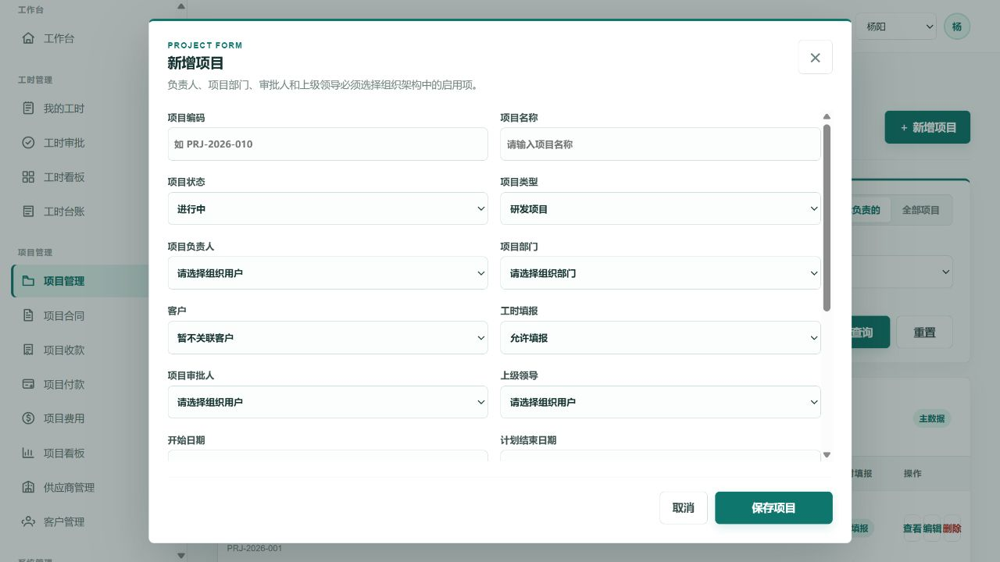
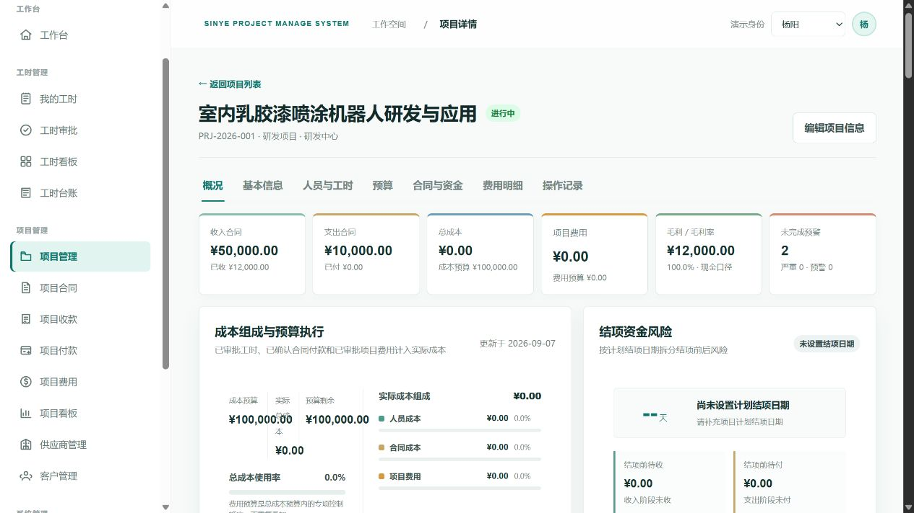
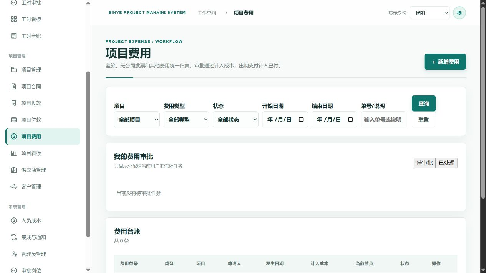
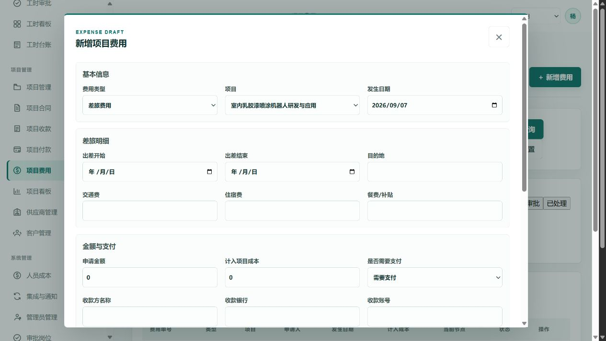
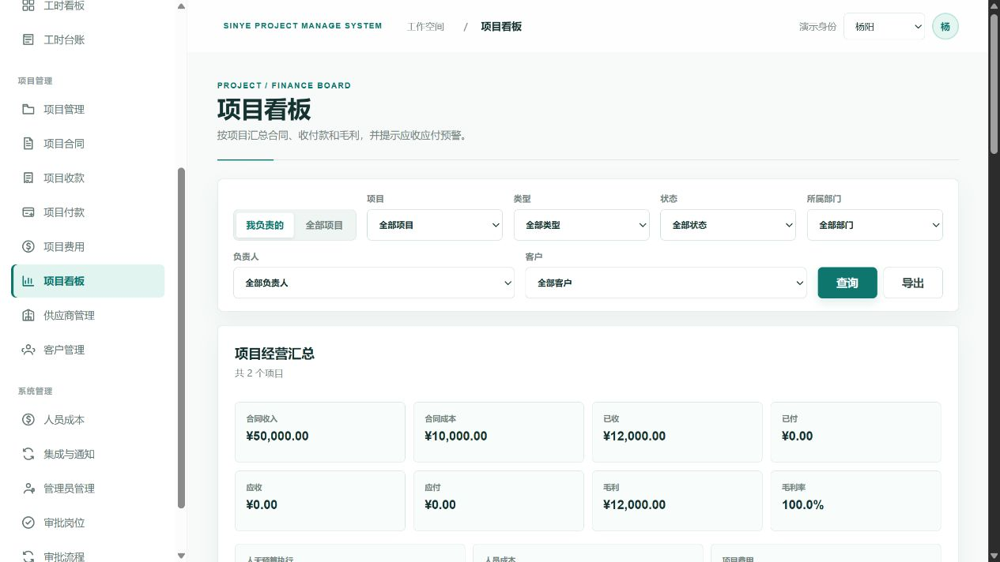
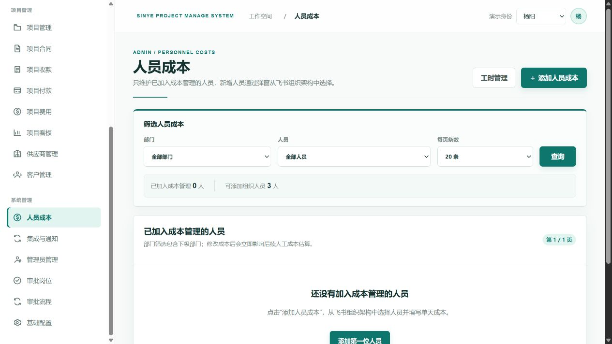
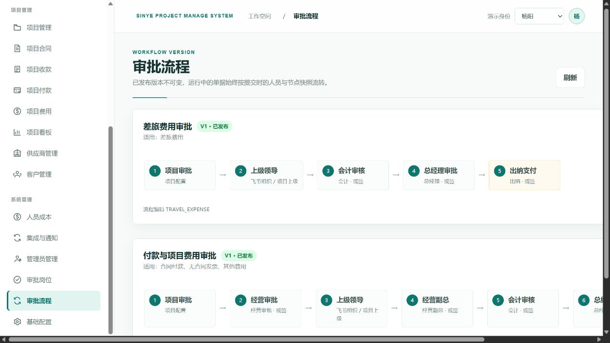

# 综合项目管理系统用户使用手册

文档版本：v3.0.56
更新时间：2026-09-07

本手册已生成正式 Word 版：`综合项目管理系统用户使用手册-v3.0.56.docx`。Word 版包含完整图文步骤和 29 张页面截图；本 Markdown 文件用于快速查阅和后续维护。

## 阅读说明

- 本版基于 v3.0.56 重新生成。
- 截图位于 `docs/assets/manual-v3.0.56/`，采用常规浏览器视窗比例，避免 4K 缩图问题。
- 系统名称统一为“综合项目管理系统”，英文标识为 “SINYE PROJECT MANAGE SYSTEM”。
- 不记录飞书 App Secret、服务器 SSH 密码等敏感信息。

## 1. 角色速查

| 角色 | 重点功能 | 常见任务 |
|---|---|---|
| 普通员工 | 工作台、我的工时、项目费用 | 填报工时、提交费用或报销、查看审批状态 |
| 工时审批人 | 工时审批、工时详情 | 处理待审批工时，查看审批时间线 |
| 项目负责人 | 工作台项目区、项目详情、项目看板 | 查看负责项目的预算、成本、合同、收付款和预警 |
| 财务/出纳 | 合同收款、合同付款、项目费用、通知中心 | 审核收付款、确认支付、处理失败通知 |
| 系统管理员 | 系统管理 | 维护组织同步、人员成本、角色权限、审批岗位、流程和基础配置 |

## 2. 登录与工作台

1. 在飞书内打开系统应用，或访问管理员提供的系统地址。
2. 点击“使用飞书登录”完成授权。
3. 首次接入时，第一个成功登录的飞书用户会初始化为系统管理员。
4. 登录后，系统按角色、菜单权限、按钮权限和数据范围显示功能。
5. 工作台上半区是项目负责人视角，下半区是员工工时视角。
6. 欢迎语按 Asia/Shanghai 当前时间动态显示，日期行只显示日期和星期。

## 3. 工时管理

### 3.1 我的工时

1. 进入“工时管理 > 我的工时”。
2. 按状态筛选草稿、审批中、已驳回或已通过记录。
3. 点击“查看详情”进入单条工时详情；草稿或驳回记录可编辑后重新提交。

### 3.2 新增工时

1. 点击“＋ 新增工时”。
2. 先选择项目类型，再选择该类型下允许填报的项目。
3. 填写开始日期和结束日期，系统自动按周一至周五工作日计算整数天数。
4. 填写项目阶段、工时类型、工作状态和工作描述。
5. 保存草稿或提交审批。

工时规则：

- 同一人员同一天不能填报多次，不同项目也不允许。
- 日期区间不能跨自然月。
- 开始日期不能晚于结束日期。
- 工时单位只有“天”，没有小时。

### 3.3 工时详情与审批

1. 工时详情展示单号、项目、日期、天数、描述、审批人和通知状态。
2. 审批人进入“工时管理 > 工时审批”，在“待我审批”处理工时。
3. 飞书工时审批卡片会直达对应工时审批详情页。
4. 审批通过后，系统更新项目已发生人天，并按审批时人员成本生成项目人员成本。

### 3.4 工时看板与台账

- 工时看板只统计工时相关内容，包括部门、项目、人员、趋势和审批状态。
- 部门筛选支持组织层级，选择上级部门时包含下级部门。
- 工时台账是后台维护功能，可按日期、部门、人员和项目筛选，并按权限修改或删除。

## 4. 项目管理

1. 项目列表只展示项目主信息：名称、编号、状态、类型、负责人、所属部门、客户和工时填报开关。
2. 可按项目类型、部门、状态、负责人、客户和标题模糊查询，列表支持分页。
3. 新增或编辑项目在弹窗完成，人员与部门来自飞书组织架构。
4. 项目详情展示概况、基本信息、人员与工时、预算、合同与资金、费用明细和操作记录。
5. 项目预算包含人天预算、成本预算和费用预算；已发生人天由已审批工时自动汇总。

成本口径：

- 实际总成本 = 已确认人员成本 + 已确认合同付款成本 + 已审批项目费用成本。
- 预算剩余 = 对应预算减已发生金额或人天。
- 人员成本按审批通过工时与审批时人员单天成本生成。

## 5. 合同、阶段与收付款

1. 合同分为收入合同和支出合同；实施项目既可能有收入合同，也可能有支出合同。
2. 新建合同可保存草稿，也可在新建时直接上传附件。
3. 点击合同名称进入合同详情，查看主信息、结算率、阶段和款单笔数。
4. 点击“查看阶段”只查看阶段列表；点击“新增阶段”才打开新增阶段弹窗。
5. 合同导入时项目字段填写项目名称，合同类型填写中文，客户/供应商填写名称，系统匹配后自动保存编码。

### 5.1 合同收款单

1. 选择项目、收入合同和合同阶段。
2. 选择收入合同后，系统自动带出客户付款方名称、付款银行和付款账号。
3. 填写金额、日期、备注并上传附件。
4. 审批通过后通知申请人，增加已收并核减已到期应收。

### 5.2 合同付款单

1. 选择项目、支出合同和合同阶段。
2. 选择支出合同后，系统自动带出供应商收款方名称、收款银行和收款账号。
3. 账号、收款方姓名和银行为必填。
4. 合同付款、费用付款和报销款使用同一个付款流程。

## 6. 项目费用

1. 费用类型包括差旅费用、无合同发票和其他费用。
2. 新建费用时选择项目、填写金额、日期、事由和说明，并上传附件。
3. 提交后按动态审批流程流转。
4. 审批通过后计入项目费用成本；出纳支付后计入已付。

## 审批流程摘要

- 差旅费用：经办人提交 → 项目负责人审批 → 会计审批 → 上级领导审批 → 财务总监审批 → 总经理审批 → 出纳支付。
- 费用付款 / 无合同发票 / 其他费用 / 合同付款：经办人提交 → 项目负责人审批 → 会计审批 → 经营审批 → 上级领导审批 → 经营副总审批 → 财务总监审批 → 总经理审批 → 出纳支付。

## 7. 项目看板与提醒

项目看板支持“我的项目”和“全部项目”范围。选择全部项目时，项目选择框会动态获取当前可访问项目列表。

| 指标 | 说明 |
|---|---|
| 人员成本 | 已审批工时 × 审批时人员单天成本 |
| 合同成本 | 支出合同付款确认后的成本 |
| 项目费用 | 差旅、无合同发票和其他费用审批通过后的成本 |
| 应收未收 | 只统计已到期收入阶段的未收金额 |
| 应付未付 | 只统计已到期支出阶段的未付金额 |

系统提醒包括工时待审批、合同收款单待审批、合同付款单待审批、项目费用待审批、合同阶段临期/到期/逾期、成本预算接近或超支、人天预算接近或超支。飞书通知只负责提醒和打开系统页面，业务状态以本系统为准。

## 8. 客户、供应商、人员成本

- 供应商和客户编码由系统自动生成，导入模板不需要填写编码。
- 供应商维护默认收款账户，合同付款单选择支出合同后可自动带出。
- 客户维护默认付款账户，合同收款单选择收入合同后可自动带出。
- 人员成本按部门和人员维护；部门筛选支持层级包含。

## 关键口径摘要

- 工时单位为天，只统计周一至周五工作日。
- 同一人员同一天不能重复填报工时。
- 人员成本按已审批工时和审批时人员单天成本生成。
- 应收未收/应付未付只统计已到期阶段余额。
- 系统统一使用 Asia/Shanghai 时区。

## 9. 系统管理

1. 集成与通知：查看飞书连接、同步组织架构、统一维护通知策略。
2. 通知中心：查看发送记录、失败原因和重试入口。
3. 管理员管理：配置角色、菜单、按钮和数据访问范围。
4. 审批岗位：维护会计、经营审批、财务总监、总经理、出纳等岗位成员。
5. 审批流程：查看各单据类型的流程节点和版本。
6. 基础配置：维护项目类型、项目状态、工时类型、项目阶段等动态下拉项。

## 10. 常见问题

| 问题 | 处理建议 |
|---|---|
| 看不到项目 | 检查是否为项目负责人、数据范围是否授权、部门是否同步、筛选条件是否限制 |
| 看不到菜单 | 检查角色菜单权限 |
| 工时提交失败 | 检查是否同日重复、跨月、项目不可填报或天数不是整数工作日 |
| 飞书没有通知 | 在通知中心查看通知记录、发送状态、失败原因和接收人 open_id |
| 导出没有下载弹窗 | 查看飞书内置浏览器下载栏或下载记录 |
| 附件预览失败 | Office 文件转换失败时可下载本地查看 |

