# 综合项目管理系统用户使用手册

文档版本：v3.0.68
更新时间：2026-09-12
适用版本：生产环境 v3.0.68（访问地址由管理员提供，生产环境为 `116.169.217.29:8088`）

> **本文件已停止维护**，请使用 `docs/01-user-manual-v3.0.70.md`（快速查阅版）或 `docs/综合项目管理系统用户使用手册-v3.0.70.docx`（逐步图文版）。

本手册基于 v3.0.56 版手册重编，覆盖 v3.0.57 至 v3.0.68 的全部改动；旧版手册 `docs/01-user-manual.md` 停止维护。

## 阅读说明

- 系统名称统一为“综合项目管理系统”，英文标识 “SINYE PROJECT MANAGE SYSTEM”。
- 文中“预算项”指统一的 8 项预算口径，承担原“成本分类 / 成本大类 / 成本小类”的归集职责（v3.0.62 起成本分类维度已下线）。
- 文中“成本单”指项目成本单，包括**项目费用单**和**人工成本结转单**两类（v3.0.61 起）。
- 文中“费用复核”指一级复核，取代原合同付款的七级审批（v3.0.61 起）。
- 截图取自 `docs/assets/manual-v3.0.56/`，为 v3.0.56 版本界面；界面细节（按钮位置、表头）以当前版本为准，口径以本文字为准。
- 不记录飞书 App Secret、服务器密码等敏感信息。

## 本次版本变更对照（v3.0.57 → v3.0.68）

| 版本 | 与使用者相关的变化 |
|---|---|
| v3.0.57 | “项目收款 / 项目付款”更名为“合同收款 / 合同付款” |
| v3.0.60 | 项目预算改为统一 8 项预算项；**项目总预算 = 启用预算项金额合计**；项目表单不再有人天预算 / 成本预算 / 费用预算 |
| v3.0.60 | 项目分类改为两级：项目大类（经营项目 / 研发项目）+ 项目小类 |
| v3.0.61 | 新增**人工成本结转单**；**工时审批不再折算人员成本**；合同付款、项目费用、人工成本统一改为**一级费用复核**；新增“费用复核”统一待办 |
| v3.0.62 | **成本分类维度取消**，费用只选预算项；8 项预算项固定，不可新增 / 删除 / 改名 |
| v3.0.63 | 前端补齐“项目费用 / 人工成本结转 / 成本单详情 / 费用复核”四个页面 |
| v3.0.64 | 新增**工时填报定时飞书提醒**（通知策略里配置时刻与范围） |
| v3.0.65 | 预算项入口收拢到**项目管理**（列表操作列“预算项”、项目详情“维护预算项”）；基础配置不再有“预算项模板” |
| v3.0.66 | 权限管理里不再显示“项目预算项”（预算项授权随“项目管理”生效） |
| v3.0.67 | 人工成本结转**无需选择预算项**，固定归集“人工费用” |
| v3.0.68 | **“人员成本”模块整体删除**；人员日成本口径取消；人工成本只看已复核的人工成本结转单 |

## 1. 系统模块地图

| 一级菜单 | 二级 / 页面 | 主要用途 |
|---|---|---|
| 工作台 | — | 个人待办、负责项目经营概况、填报与审批进度 |
| 工时管理 | 我的工时、工时审批、工时看板、工时台账 | 填报、审批、统计与后台维护工时 |
| 项目管理 | 项目列表、项目详情、预算项 | 维护项目主数据与项目预算项 |
| 项目合同 | 收入合同、支出合同、合同阶段 | 合同台账与收付款计划 |
| 合同收款 | 收款单 | 收入合同回款登记与复核 |
| 合同付款 | 付款单 | 支出合同付款与费用复核 |
| 项目费用 | 费用单台账 | 非合同类费用按预算项归集 |
| 人工成本结转 | 结转单台账 | 财务按月把人工成本结转到项目 |
| 费用复核 | 待复核 / 已处理 / 全部 | 付款单、费用单、结转单统一复核 |
| 项目看板 | — | 项目群经营、收付、毛利与账龄分析 |
| 客户与供应商 | 客户管理、供应商管理 | 往来单位主数据与账户 |
| 收付款复核 | — | 出纳对收付款单据的复核 |
| 集成与通知 | 集成概况、通知中心 | 飞书连接、组织同步、通知策略与发送记录 |
| 权限管理 | 角色权限、人员授权 | 角色、菜单、操作、数据范围 |
| 复核岗位 | — | 维护费用复核、收款复核等岗位成员 |
| 基础配置 | 平铺选项、分类体系 | 下拉选项与项目分类树 |

## 2. 角色速查

| 角色 | 重点功能 | 常见任务 |
|---|---|---|
| 普通员工 | 工作台、我的工时、项目费用 | 填报工时、提交费用单、查看审批状态 |
| 工时审批人 | 工时审批、工时详情 | 处理待我审批的工时，查看通知状态 |
| 项目负责人 | 工作台项目区、项目详情、项目看板 | 查看负责项目的预算项执行、合同、收付款与预警 |
| 财务 / 会计 | 人工成本结转、项目费用、费用复核 | 按月结转人工成本、录入费用、复核单据 |
| 出纳 / 收付款复核 | 合同收款、合同付款、收付款复核 | 复核收付款单、确认收支 |
| 系统管理员 | 权限管理、复核岗位、基础配置、集成与通知 | 维护角色权限、岗位成员、下拉选项、通知策略 |

内置角色（可在“权限管理 → 角色列表”查看）：系统管理员、项目经营管理员、项目负责人、出纳、工时管理员、工时审批人、费用复核员、财务。内置角色只读，需要差异化授权请新建自定义角色。

## 3. 登录与工作台

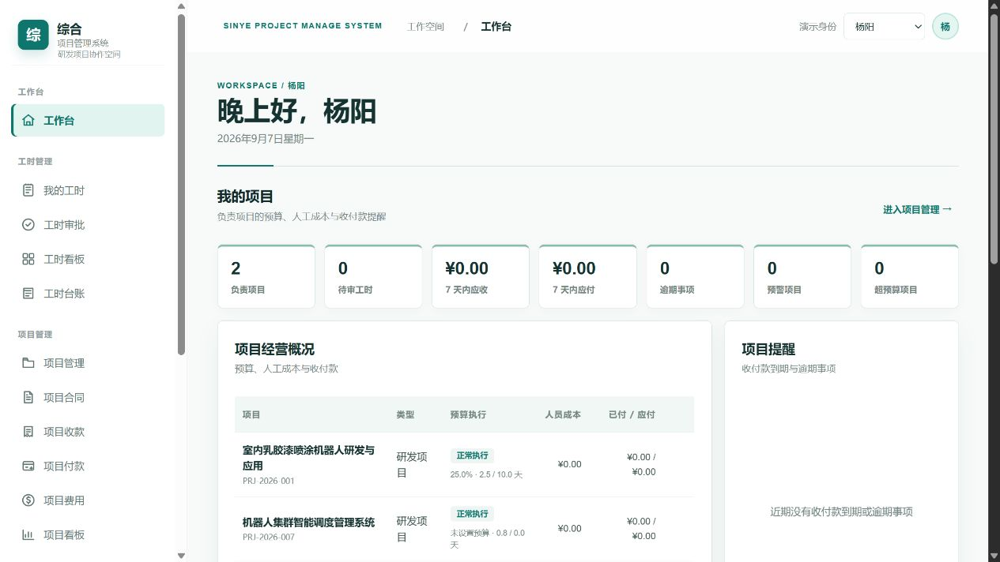

1. 在飞书内打开系统应用，或访问管理员提供的系统地址。
2. 点击“使用飞书登录”完成授权。
3. 首次接入时，第一个成功登录的飞书用户会被初始化为系统管理员。
4. 登录后，系统按**角色 + 菜单权限 + 操作权限 + 数据范围**显示功能。
5. 工作台上半区是项目负责人视角，下半区是员工工时视角。
6. 欢迎语按 `Asia/Shanghai` 当前时间动态显示，日期行只显示日期和星期。

工作台内容：

- 项目负责人区指标：负责项目、待审工时、7 天内应收、7 天内应付、逾期事项、预警项目、超预算项目。
- “项目经营概况”表列：项目 / 分类 / 预算执行 / 人员成本 / 已付 / 应付 / 已收 / 应收 / 预警。
- 员工工时区：本月工时审批数、我的审批中、待我审批、草稿待修改。
- 快捷入口：进入项目管理、填报工时、新增合同收款 / 付款、工时审批。

## 4. 工时管理

### 4.1 我的工时

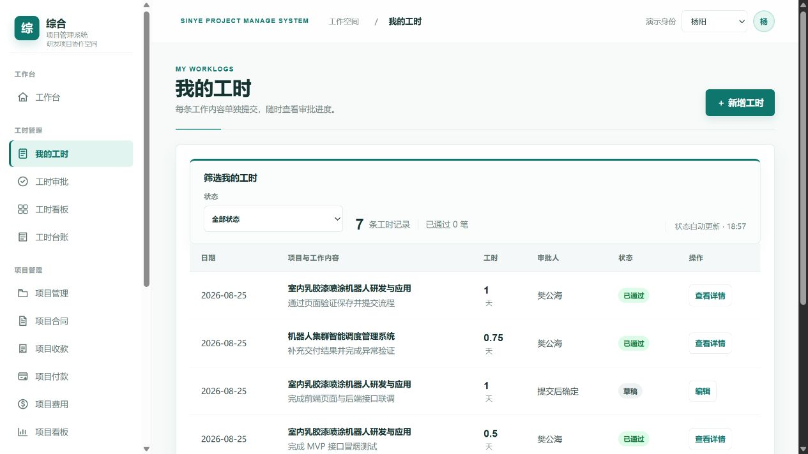

1. 进入“工时管理 > 我的工时”。
2. 按状态筛选：全部 / 草稿 / 审批中 / 已驳回 / 已通过。
3. 列表列：日期、项目与工作内容、工时（天）、审批人、状态、操作。
4. 草稿与已驳回记录可“编辑”或“修改并提交”，其余记录“查看详情”。

### 4.2 新增工时

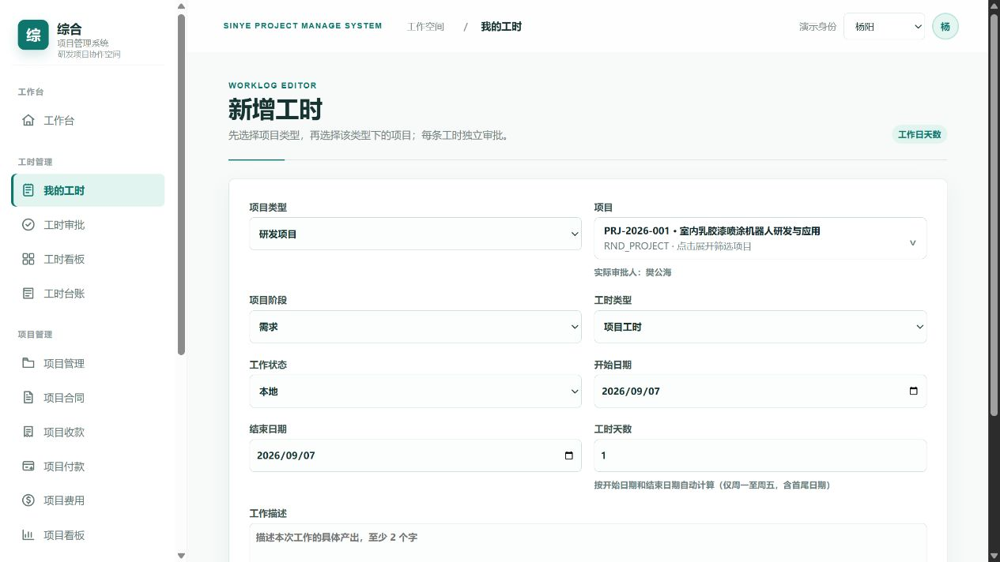

1. 点击“＋ 新增工时”。
2. **先选择项目大类**（经营项目 / 研发项目），再点项目选择框，按名称或编码搜索并选择项目。
3. 选择项目阶段、工时类型、工作状态。
4. 填写开始日期与结束日期，系统按**周一至周五**自动计算整数天数，可手工微调。
5. 填写工作描述，保存草稿或提交审批。
6. 表单下方会显示“实际审批人”；若本人就是项目审批人，系统会提示改由上级领导审批。

工时规则：

- 同一人员同一天不能重复填报，不同项目也不允许。
- 日期区间不能跨自然月；开始日期不能晚于结束日期。
- 工时单位只有“天”，没有小时。
- **工时审批通过后不再折算人员成本**（v3.0.61 起）；项目人工成本由财务录入的“人工成本结转单”确认。
- 只有状态为“进行中”且开启“允许填报”的项目才会出现在项目选择框里。

### 4.3 工时详情与审批

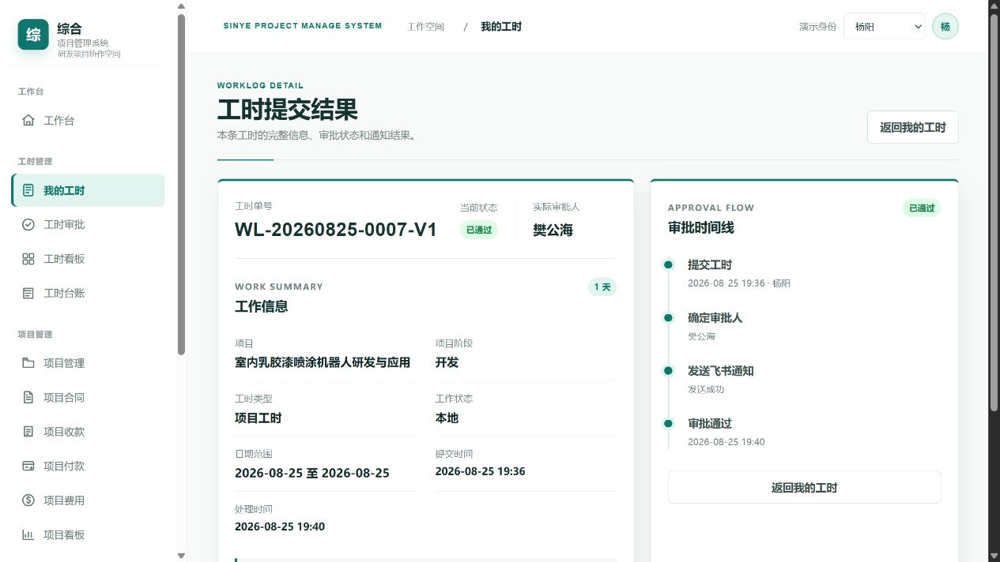

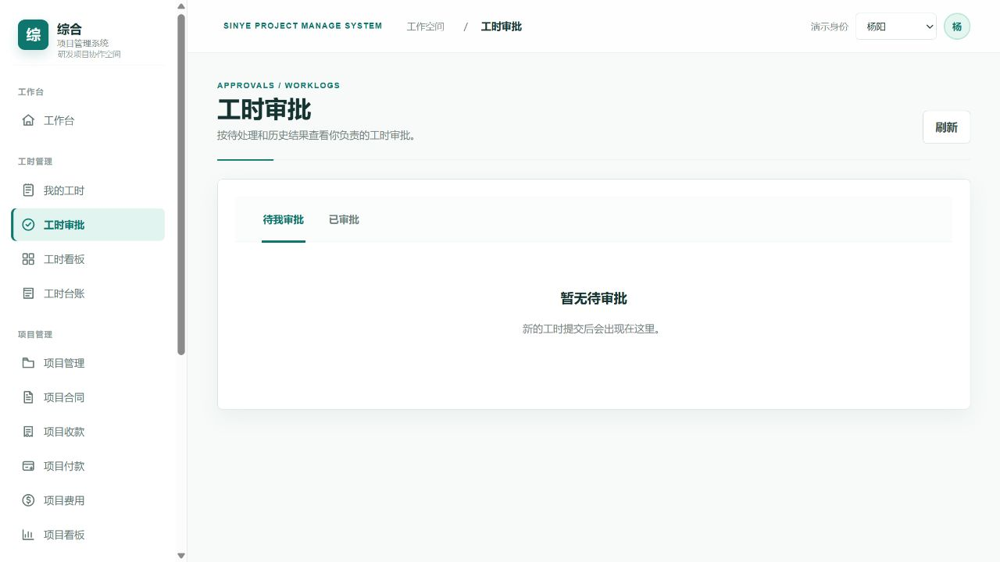

1. 工时详情展示工时单号、当前状态、实际审批人、项目、阶段、工时类型、工作状态、日期范围、提交与处理时间、审批意见、工作描述和驳回原因，并展示“提交工时 → 确定审批人 → 发送飞书通知 → 等待处理”的时间线。
2. 审批人进入“工时管理 > 工时审批”，在“待我审批”处理，“已审批”查看历史。
3. 审批动作：通过 / 驳回 / 重新发送通知；驳回原因至少填写 2 个字。
4. 飞书工时审批卡片可直达该条工时详情页。

### 4.4 工时看板

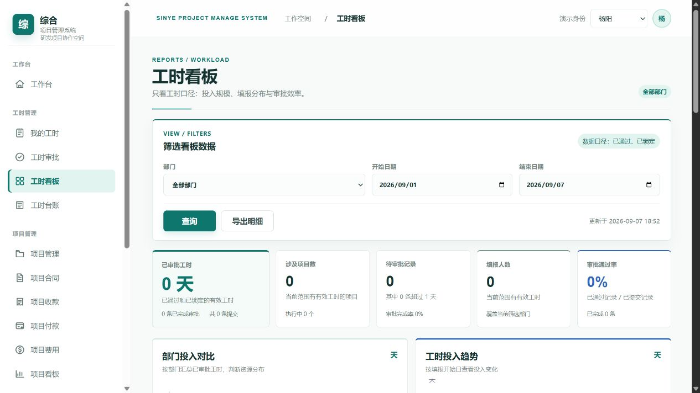

- 只看工时口径：已审批工时、涉及项目数、待审批记录、填报人数、审批通过率。
- 筛选条件：部门（支持层级，选上级部门含下级）、开始日期、结束日期。
- 图表：部门投入对比、工时投入趋势、项目投入排行、人员工时排行、审批状态分布、工作阶段分布、项目阶段占比、工时类型分布。
- 支持“导出明细”（需工时管理导出权限）。
- 数据口径为已通过、已锁定的有效工时。

### 4.5 工时台账（后台维护）

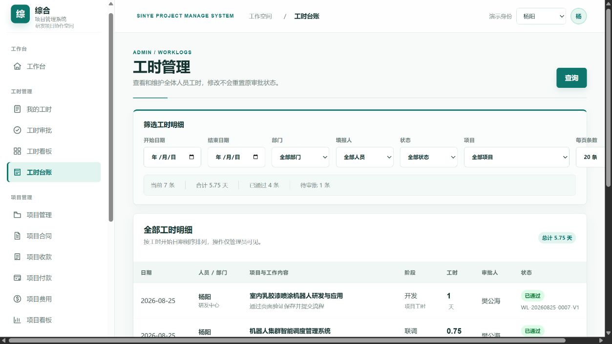

- 入口：工时管理 > 工时台账，仅具备工时管理权限的人员可见。
- 筛选：开始日期、结束日期、部门、填报人、状态（已通过 / 审批中 / 草稿 / 已驳回 / 已锁定）、项目。
- 操作：编辑、删除、导出明细。修改工时内容不会重置原有审批状态与审批记录。
- 导出文件名形如 `xinye-worklog-ledger-*.csv`，范围与当前筛选一致。

### 4.6 工时填报定时提醒（v3.0.64 新增）

- 配置入口：集成与通知 > 通知策略 > “填报提醒”分组。
- 可配置项：
  - **提醒时间**：多个时刻用逗号分隔，例如 `09:00, 17:30`；只在工作日（周一至周五）生效，留空按默认 09:00。
  - **通知范围**：全部在职人员 / 指定部门 / 指定人员。
  - **只提醒当天未填报的人**：默认开启，已填报（含草稿）的人自动跳过。
- 同一人同一天同一时刻只发一次，重复扫描不会重复打扰。
- 配置完成后可点“立即发送一次”验证（策略未启用时会提示先启用）。
- 该策略默认停用，管理员启用并保存后才会真正发送。

## 5. 项目管理

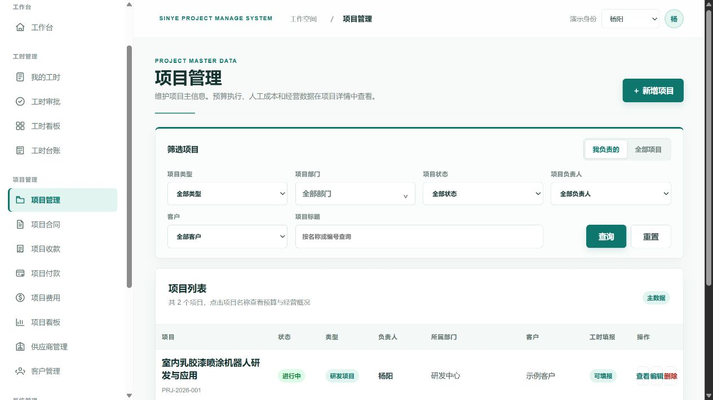

1. 列表支持“我负责的 / 全部项目”范围切换。
2. 筛选条件：项目大类、项目小类（需先选大类）、项目部门（树形，可含下级）、项目状态、负责人、客户、项目标题（名称或编号模糊查询）。
3. 表格列：项目 / 状态 / 类型 / 负责人 / 所属部门 / 客户 / 工时填报（可填报 / 不可填报）/ 操作。
4. 操作列：查看、编辑、**预算项**、删除。

### 5.1 项目表单字段

- 项目编码、项目名称。
- **项目大类**（经营项目 / 研发项目）与**项目小类**（按所选大类联动，可暂不指定）：
  - 经营项目小类：委托研发、设备销售、技术服务、机器人施工、设备租赁。
  - 研发项目小类：自主研发、外部申报。
- 项目状态：进行中 / 验收中 / 已暂停 / 已完成。
- 项目负责人、项目部门、客户（可暂不关联）。
- **工时填报**：允许填报 / 关闭填报。关闭后该项目不会出现在工时填报的项目选择框里。
- 项目审批人、上级领导、开始日期、计划结束日期、项目说明。
- 负责人、部门、审批人、上级领导必须选择组织架构中的启用项；部门为空时请先到“集成与通知”同步组织架构。

### 5.2 项目预算项（唯一维护入口）

入口：项目列表操作列“预算项”，或项目详情“预算”页签的“维护预算项”。

- 预算项统一固定为 8 项，不可新增或删除，只维护本项目的**预算金额、启用状态和备注**。
- **项目总预算 = 启用预算项的预算金额合计**，保存后自动回写到项目。
- 8 项预算项：

| 序号 | 预算项 | 主要归集来源 |
|---|---|---|
| 1 | 人工费用 | 人工成本结转单 |
| 2 | 材料、设备采购 | 支出合同付款 / 项目费用 |
| 3 | 水、电、燃气费用 | 支出合同付款 / 项目费用 |
| 4 | 委托、分包、外包费用 | 支出合同付款 / 项目费用 |
| 5 | 差旅费用 | 支出合同付款 / 项目费用 |
| 6 | 包装、运输费用 | 支出合同付款 / 项目费用 |
| 7 | 租赁费、折旧费 | 支出合同付款 / 项目费用 |
| 8 | 其他费用 | 支出合同付款 / 项目费用 |

- 表格列：预算项 / 适用来源 / 预算金额 / 已发生 / 剩余 / 启用 / 备注。
- 如项目缺少预算项，可点“按后台模板补齐”。
- 预算项**不需要单独授权**，有“项目管理”权限即可维护。

### 5.3 项目详情

项目详情分为 7 个页签：概况、基本信息、人员与工时、预算、合同与资金、费用明细（需权限）、操作记录。

- **概况**：收入合同、支出合同、总成本、项目费用、毛利与毛利率（现金口径）、未完成预警；成本组成与预算执行、结项资金风险、合同阶段收付款分析、风险与待处理事项。
- **基本信息**：项目编码、名称、大类、小类、状态、负责人、部门、客户、工时填报开关、审批人、上级领导、起止日期、说明。
- **人员与工时**：负责人 / 审批人 / 上级领导 / 已发生人天，以及工时明细（最多 50 条）。
- **预算（预算项执行）**：
  - 总预算（启用预算项合计）、实际总成本、人工费用、已发生合同成本、已发生项目费用、预算剩余，以及成本执行率。
  - 预算项明细表：预算项 / 适用来源 / 预算金额 / 已发生 / 剩余 / 使用率。
  - 可点“维护预算项”进入维护弹窗。
- **合同与资金**：收入合同与支出合同列表、收款单 / 付款单、阶段计划与结算进度；可从这里进入合同管理、收款、付款。
- **费用明细**：项目成本单台账（单据编号 / 预算项 / 申请人 / 发生日期 / 金额 / 状态），并展示非人工预算、合同成本、项目费用、非人工剩余。
- **操作记录**：项目、合同、收付款和预算变更的审计日志。

## 6. 预算、成本与归集口径（重点）

### 6.1 三句话口径

1. **预算**：项目总预算 = 启用预算项金额合计；项目层面不再单独设置人天预算、成本预算、费用预算。
2. **归集**：每一笔成本只选**一个预算项**；不再选择成本大类 / 成本小类（v3.0.62 起该维度已下线）。
3. **实际总成本 = 人工费用 + 合同成本 + 项目费用**，三类都取**已复核通过**的单据，并扣除冲销。

### 6.2 各来源如何归集

| 来源单据 | 预算项 | 计入成本的时点 |
|---|---|---|
| 人工成本结转单 | 固定归集“人工费用”，无需选择 | 费用复核通过后 |
| 项目费用单 | 手工选择项目内启用的预算项（也可选“不归集”） | 费用复核通过后 |
| 支出合同付款单 | 手工选择预算项；留空时由后端按历史规则归集 | 费用复核通过后 |
| 支出合同 | 必须选择预算项 | 通过付款单体现 |
| 收入合同 | 不填写预算项 | — |
| 工时 | 不再折算成本，只统计人天 | — |

### 6.3 人员成本的变化（务必注意）

- 系统**不再维护“人员日成本”**，“人员成本”模块已于 v3.0.68 整体删除。
- 项目的人工费用只来自**财务录入并复核通过的人工成本结转单**。
- 因此：没有结转单的项目，人工费用显示为 0 是**真实口径**，不是数据缺失。
- 工时负荷 / 项目看板 / 项目详情中的人工费用口径与之一致。

## 7. 项目合同

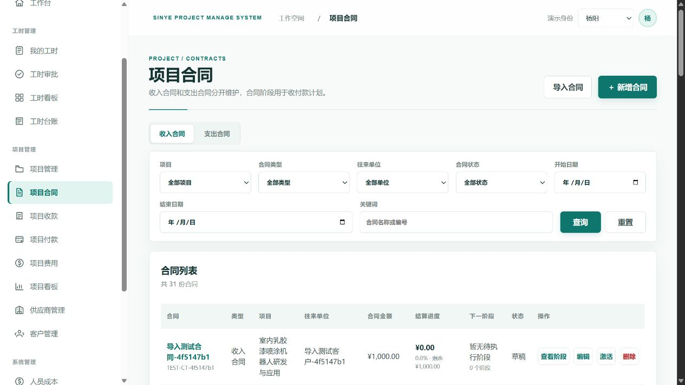

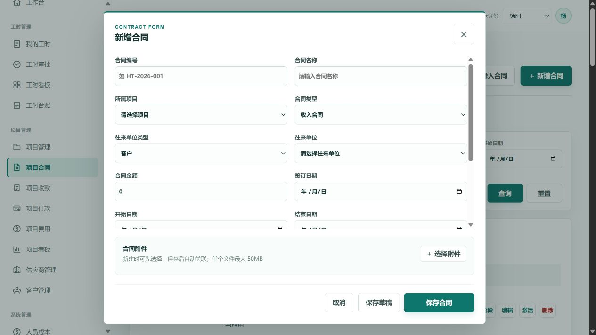

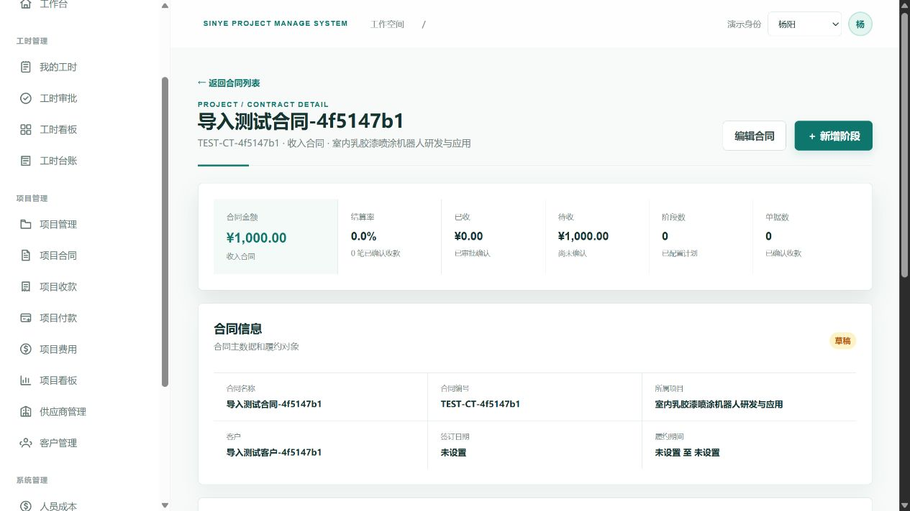

1. 合同分为**收入合同**和**支出合同**，分页签维护；实施类项目既可能有收入合同，也可能有支出合同。
2. 合同字段：编号、名称、所属项目、合同类型、往来单位类型（客户 / 供应商）、往来单位、**预算项（仅支出合同必选）**、签订日期、起止日期、状态（执行中 / 已完成 / 草稿）、说明与附件。
3. 新建合同可“保存草稿”，草稿合同在列表可“激活”；新建时即可上传附件，保存成功后自动关联。
4. 合同阶段用于收付款计划：阶段名称、阶段金额、计划日期、提前提醒天数、排序、是否暂停提醒。
5. “查看阶段”只看阶段列表，“新增阶段”才打开新增弹窗。
6. 合同详情展示：概览（合同金额、结算率、已收 / 已付、待收 / 待付、阶段数、单据数）、合同信息、阶段详情、合同说明、合同附件（支持 Word / Excel / PPT / PDF / 图片预览与下载）。
7. **批量导入**：项目字段填写项目名称，合同类型填写中文（收入 / 支出），客户 / 供应商填写名称，系统匹配后自动保存编码；匹配失败会整批拒绝，请按提示修正后重新导入。

## 8. 合同收款与合同付款

### 8.1 合同收款单

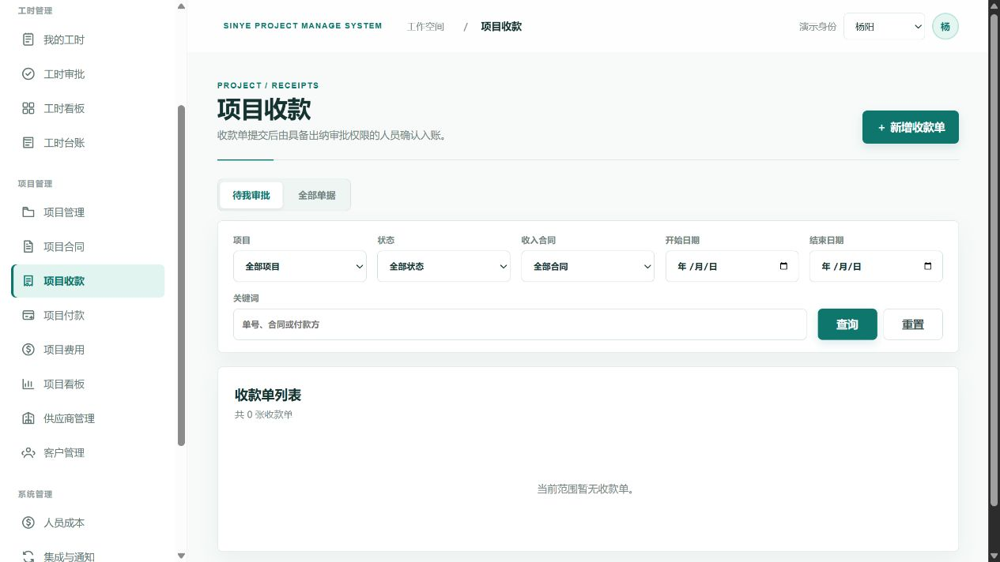

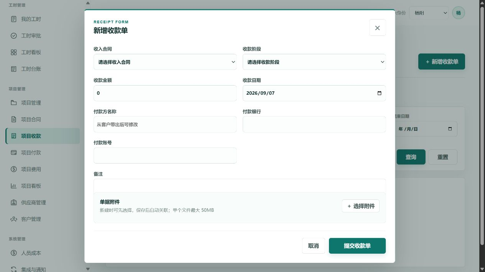

1. 选择项目、收入合同与合同阶段，系统会提示“计划 X · 已收 X · 剩余 X”。
2. 选择收入合同后自动带出客户付款方名称、付款银行与付款账号，可手工修改。
3. 填写收款金额、收款日期、备注并上传附件。
4. 提交后由**收款复核岗位**或具备收付款复核权限的人员确认；确认后计入项目已收，并按阶段金额核减应收。
5. 状态：待出纳审批 / 已确认 / 已驳回 / 已冲销。

### 8.2 合同付款单

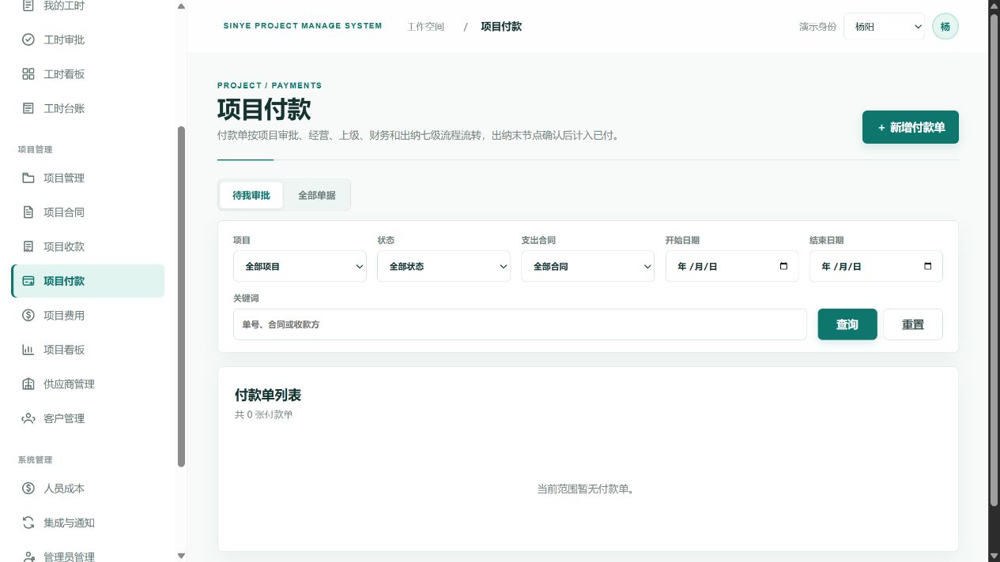

1. 选择项目、支出合同与合同阶段，系统会提示“计划 X · 已付 X · 剩余 X”。
2. 选择支出合同后自动带出供应商收款方名称、收款银行与收款账号（留空时按供应商主数据带出）。
3. 选择**预算项**（支出合同的归集口径），填写付款金额、付款日期、备注并上传附件。
4. **提交后走一级费用复核**（v3.0.61 起取消七级审批）：复核通过后即计入项目成本与已付，并按阶段金额核减应付。
5. 状态：草稿 / 待复核 / 已确认 / 已驳回 / 已冲销；已确认的单据可由复核人冲销。
6. 历史单据若仍显示多级审批轨道，属于升级前生成的记录，处理方式不变。

## 9. 项目费用（项目费用单）

1. 入口：项目费用。页面标题为“项目费用”，页面说明：“项目发生的各类费用，按统一 8 项预算项归集，复核通过后计入项目成本。”
2. 筛选：项目、状态、开始日期、结束日期、单号 / 说明关键词。
3. 台账列：单据编号 / 项目 / 预算项 / 申请人 / 发生日期 / 金额 / 状态 / 操作。
4. 新增费用单（＋ 新增费用单）：
   - 基本信息：项目、**发生日期**、金额。
   - 预算归集：选择本项目的预算项，也可选择“不归集”。
   - 附件与说明：上传凭证（支持 Word / Excel / PPT / PDF / 图片），填写说明。
   - 可“保存草稿”，或“提交复核”。
5. 状态流转：草稿 → 待复核 → 已通过 / 已驳回 → 已冲销。

## 10. 人工成本结转（人工成本结转单）

1. 入口：人工成本结转。页面说明：“按会计期间把人工成本结转到项目，复核通过后计入项目成本。”
2. 与项目费用共用一套页面，差异在于：
   - 筛选与列表列展示**会计期间**（YYYY-MM）而不是发生日期。
   - 新增时填写**会计期间**与金额，**预算项固定为“人工费用”，无需选择也不可修改**。
3. 同一个项目同一个会计期间允许录入多张结转单，详情会提示“同期间单据数”，仅作提示，不阻止录入。
4. 提交后同样进入费用复核，复核通过才计入项目人工费用。

## 11. 费用复核（统一待办）

1. 入口：费用复核。三类单据混排在同一队列：**合同付款单、项目费用单、人工成本结转单**。
2. 三个页签：待复核（角标数量）/ 已处理 / 全部。
3. 清单列：单据编号 / 单据类型 / 项目 / 预算项 / 申请人 / 金额 / 提交时间 / 状态 / 操作。
4. 操作：查看（跳付款详情或成本单详情）、通过、驳回（驳回原因至少 2 个字）。
5. 复核资格：具备 `cost_review` 审批权限，或属于“费用复核”岗位的有效成员。复核是岗位制全局职责，不受项目数据范围限制。
6. 成本单详情里还有“冲销”动作：已通过的单据冲销后按**净额口径**扣减项目成本，原流水保留可追溯。

## 12. 项目看板

1. 筛选：范围（我负责的 / 全部项目）、项目、项目大类、状态、所属部门、负责人、客户；支持导出。
2. 指标卡：
   - 经营类：合同收入、合同成本、已收、已付、应收、应付、毛利、毛利率。
   - 成本类：已发生人天（仅工时事实，不作为预算项）、人工费用（已复核通过的人工成本结转单）、项目费用（费用单确认成本）、实际总成本、总预算使用率、非人工预算使用率。
3. 图表：收支对比、项目毛利排行、收付款趋势（近 6 个月）、应收账龄、应付账龄。
4. 下钻：点击表格行进入项目详情；点击预警可跳到合同收款或合同付款并自动按项目筛选。

## 13. 客户与供应商

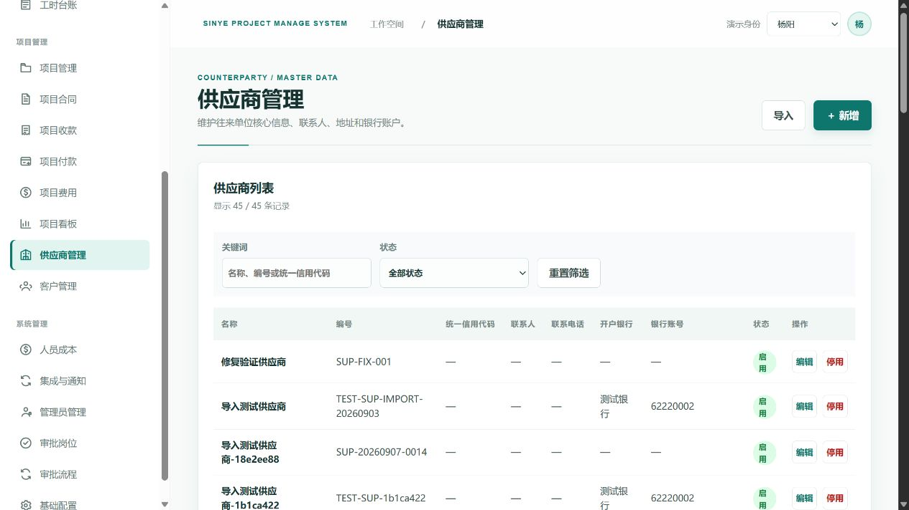

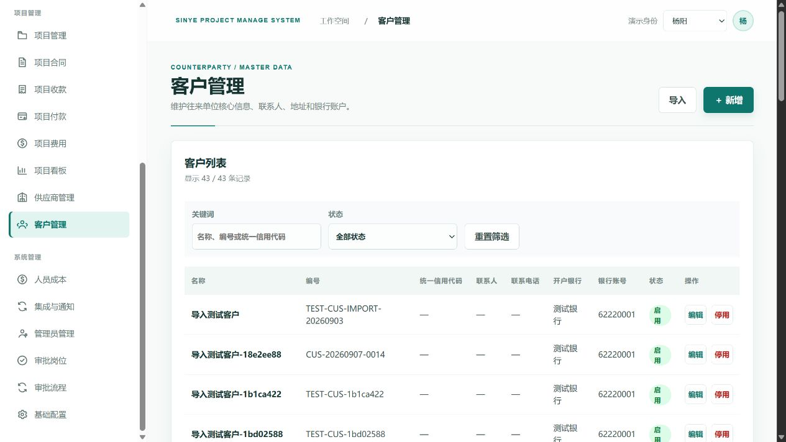

1. 两个页面共用同一套布局：客户管理、供应商管理。
2. 列表列：名称（含简称）/ 编号 / 统一信用代码 / 联系人 / 联系电话 / 开户银行 / 银行账号 / 状态 / 操作。
3. **编码由系统自动生成**，导入模板无需填写编码列。
4. 供应商维护默认收款账户，合同付款单选择支出合同后可自动带出；客户维护默认付款账户，合同收款单选择收入合同后可自动带出。
5. 支持批量导入：先下载模板，填写后上传，系统先预览校验再写入。
6. 操作：编辑、停用（已使用的单位建议停用而不是删除）。

## 14. 系统管理

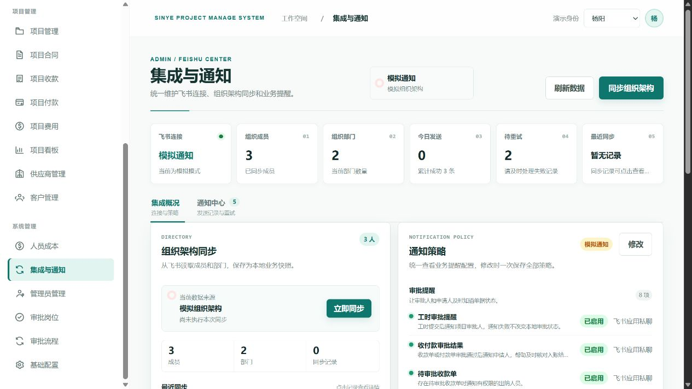

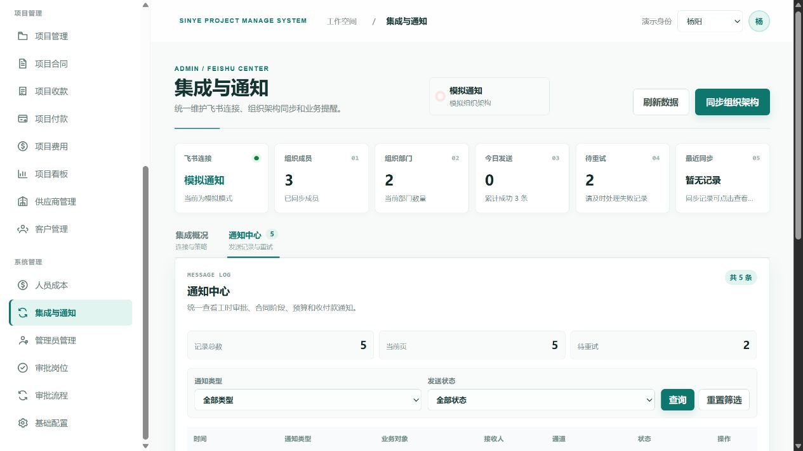

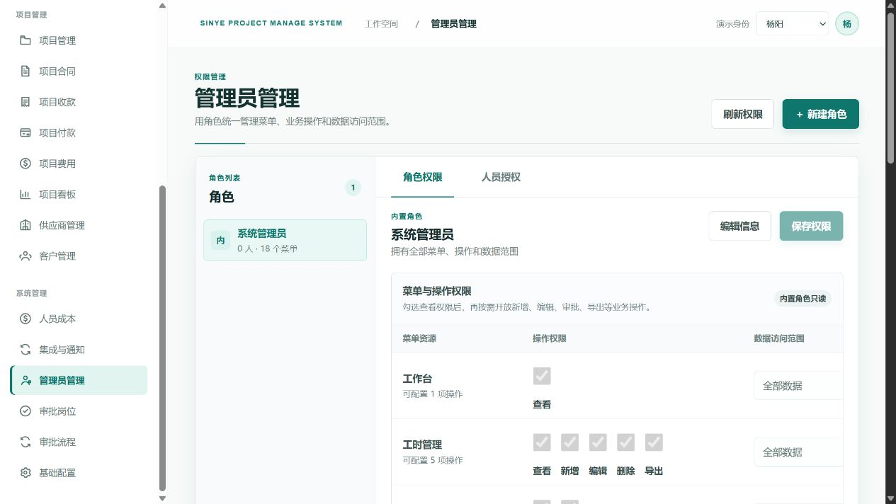

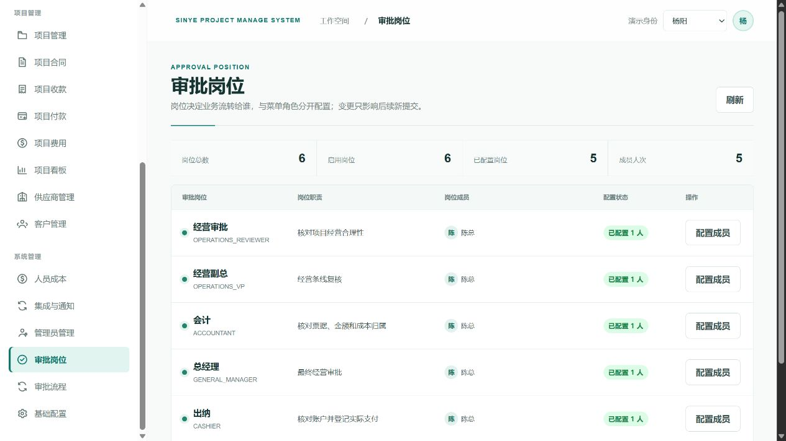

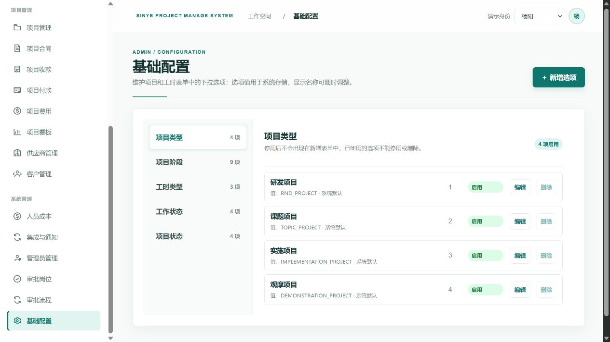

### 14.1 集成与通知

- 集成概况：飞书连接状态、组织成员与部门数量、今日发送成功数、待重试数量、最近同步记录；可“立即同步”组织架构。
- 通知策略按分组管理：
  - **审批提醒**：工时审批、收付款审批结果、各类待复核单据。
  - **合同阶段**：临期（可设提前天数）、到期、逾期。
  - **经营预警**：成本预算接近上限、成本预算超支。
  - **填报提醒**：工时填报定时提醒（见 4.6）。
- 每行显示启用状态与通道（飞书应用 / 群机器人 / 仅记录），点“修改”在弹窗里统一编辑后“统一保存”。
- 通知中心：按通知类型与发送状态筛选，可查看详情、失败原因、接收人，并“重新发送”。
- 通知边界：**本地审批状态是唯一业务依据**，飞书只负责提醒与入口跳转。

### 14.2 权限管理（角色权限）

- 左栏角色列表：内置角色（标“内”）与自定义角色（标“自”），显示人数与菜单数。
- 右栏两个页签：
  - **角色权限**：菜单资源 × 操作权限（查看 / 新增 / 编辑 / 删除 / 审批 / 导出 / 同步 / 配置 / 冲销）× 数据访问范围（仅本人 / 负责项目 / 本部门及下级 / 全部数据）。
  - **人员授权**：为人员绑定一个或多个角色，权限按并集生效；可查看某人的“生效权限”来源。
- 内置角色只读，需要调整请新建自定义角色。
- 权限管理里不会出现已下线菜单（审批流程、预算项模板、项目预算项），历史残留授权会在系统启动时自动清理，不会阻断保存。

### 14.3 复核岗位

- 岗位决定单据流转给谁，与菜单角色分开配置；**变更只影响后续新提交的单据**。
- 内置岗位：费用复核、收款复核、经营审批、经营副总、会计、财务总监、总经理、出纳。
- 可维护岗位成员；岗位为“或签”时，任一成员处理即完成该节点。
- 只被拉进复核岗位、没有单独业务角色的人，也能看到并使用费用复核入口。

### 14.4 基础配置

- 左栏为平铺下拉选项：项目阶段、工时类型、工作状态、项目状态。
- 右栏维护选项的显示名称、排序与启用状态；**存储值创建后不可修改**；停用后不再出现在新增表单中；系统默认项不能删除。
- “分类体系”卡片维护**项目分类树**：先建大类，再在大类下挂小类，支持编辑、启用 / 停用、删除；项目表单的大类 / 小类按此联动。
- 预置分类树：经营项目（委托研发、设备销售、技术服务、机器人施工、设备租赁）、研发项目（自主研发、外部申报）。
- 成本归集统一使用 8 项预算项，基础配置里不再维护成本分类，也不再有“预算项模板”。

## 15. 通知类型一览

| 分组 | 通知类型 | 触发时机 |
|---|---|---|
| 审批提醒 | 工时审批提醒 | 工时提交后通知审批人 |
| 审批提醒 | 合同收付款审批结果 | 收付款复核完成通知申请人 |
| 审批提醒 | 合同付款待复核 | 付款单提交后通知费用复核岗位 |
| 审批提醒 | 项目费用待复核 | 费用单提交后通知费用复核岗位 |
| 审批提醒 | 人工成本待复核 | 结转单提交后通知费用复核岗位 |
| 审批提醒 | 费用复核结果 | 复核通过 / 驳回通知申请人 |
| 合同阶段 | 合同阶段临期 / 到期 / 逾期 | 按阶段计划日期与提前天数扫描 |
| 经营预警 | 成本预算接近上限 / 成本预算超支 | 项目成本达到阈值 |
| 填报提醒 | 工时填报提醒 | 每个工作日按配置时刻提醒未填报人员 |

## 16. 关键口径速查

- 工时单位为天，只统计周一至周五，含首尾日期；同一人同一天不可重复填报；不可跨月。
- **工时不再折算成本**；人工费用只认已复核的人工成本结转单。
- 项目总预算 = 启用预算项金额合计；8 项预算项固定不可增删。
- 实际总成本 = 人工费用 + 合同成本 + 项目费用，均取已复核单据并扣除冲销。
- 合同付款、项目费用单、人工成本结转单统一走**一级费用复核**；合同收款走**收款复核 / 收付款复核**。
- 应收未收 / 应付未付只统计已到期阶段的余额。
- 系统统一使用 `Asia/Shanghai` 时区。
- 飞书只负责身份、提醒与入口，业务状态以本系统为准。

## 17. 常见问题

| 问题 | 处理建议 |
|---|---|
| 工时填报里选不到项目 | 依次检查：① 是否先选了正确的项目大类；② 项目状态是否为“进行中”；③ 项目是否开启“允许填报”；④ 当前账号是否有该项目的数据范围 |
| 看不到某个菜单 | 检查角色是否勾选该菜单的“查看”权限，以及角色是否被停用 |
| 权限保存失败 | 重新打开角色权限页再保存；已下线菜单的授权会在启动时自动清理，不会阻断保存 |
| 项目人工费用显示为 0 | 该系统只统计已复核通过的人工成本结转单；请财务在“人工成本结转”录入并复核 |
| 单据提交后找不到审批入口 | 付款单、费用单、结转单请到“费用复核”处理；收款单请到“合同收款 / 收付款复核”处理 |
| 工时提交失败 | 检查是否同日重复、跨月、项目不可填报或天数不是整数工作日 |
| 飞书没有收到通知 | 到“通知中心”查看发送记录、状态、失败原因与接收人，可重新发送 |
| 导出没有下载弹窗 | 查看飞书内置浏览器下载栏或下载记录 |
| 附件预览失败 | Office 文件转换失败时可下载到本地查看 |
| 下拉选项里没有需要的选项 | 联系管理员到“基础配置”或“分类体系”维护 |
