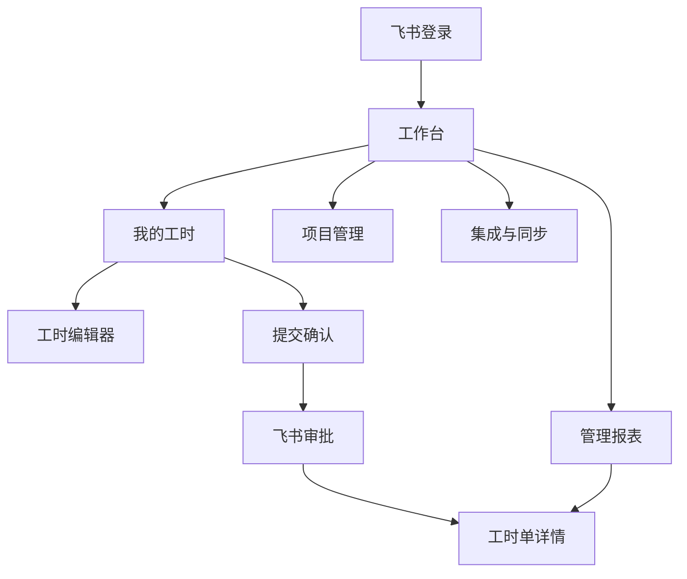

# 芯烨工时管理系统交互设计

> 版本：v1.0.1 ｜ 日期：2026-08-25 ｜ 状态：已修订

## 0. 设计 Token

目标平台：桌面 Web 管理台，兼容飞书内置浏览器；移动端提供响应式填报和审批状态查看。

| Token | 取值 | 说明 |
|-------|------|------|
| 主色 | `#0F766E` | 主操作、链接、选中状态 |
| 成功/警告/错误/信息 | `#15803D` / `#B45309` / `#B91C1C` / `#2563EB` | 与文字/图标同时表达 |
| 页面/卡片/浮层背景 | `#F6F8FA` / `#FFFFFF` / `#FFFFFF` | 控制层级，不堆叠卡片 |
| 标题/正文/次文字/边框 | `#17202A` / `#344054` / `#667085` / `#D0D5DD` | WCAG AA 对比度 |
| 字号阶梯 | 12 / 14 / 16 / 18 / 24 / 30px | 辅助、次正文、正文、小节、标题、展示数字 |
| 间距基准 | 4 / 8 / 16 / 24 / 32px | 所有间距使用 4 的倍数 |
| 圆角 | 4 / 6 / 8px | 管理台控件和卡片最多 8px |
| 阴影 | `0 1px 3px rgba(16,24,40,.08)` | 只用于浮层和必要的卡片 |
| 最小点击目标 | 44px | Web 与移动端统一热区 |

字体使用 `system-ui, "PingFang SC", "Microsoft YaHei", sans-serif`；数字使用等宽数字特性，表格正文不小于 14px。

## 1. 页面清单

| 编号 | 页面 | 入口 | 对应 PRD 功能 |
|------|------|------|--------------|
| P1 | 工作台 | 登录后默认页 | F2、F8、F10 |
| P2 | 我的工时 | 主导航 | F4、F5、F7 |
| P3 | 工时编辑器 | P2 新增/编辑 | F4 |
| P4 | 提交确认 | P2 提交操作 | F5、F6 |
| P5 | 工时单详情 | P2/报表下钻 | F5、F6、F7 |
| P6 | 管理报表 | 主导航，按权限显示 | F8 |
| P7 | 项目管理 | 管理员入口 | F3、F9 |
| P8 | 集成与同步 | 管理员入口 | F2、F6、F9、F10 |

## 2. 信息架构

## 3. 核心用户流程

### 流程 1：新增并提交工时

1. 用户登录后进入工作台，系统显示当前周期、个人待办和最近工时。
2. 用户进入“我的工时”，选择周期并点击“新增工时”。
3. 选择项目后，系统只展示“是否可填报”的项目；自动带出项目负责人、审批人和所属部门。
4. 用户填写日期、项目阶段、工时类型、工时数量、出差/本地状态和工作描述。
5. 用户保存草稿；系统提示校验结果，不阻塞继续填写的非必填字段。
6. 用户点击“提交本周期”，系统展示明细数量、工时合计、审批人和异常项。
7. 用户确认后系统创建工时单并调用飞书审批；成功后进入审批中，失败则保留草稿并显示重试入口。

### 流程 2：审批结果同步

1. 审批人在飞书审批中处理实例。
2. 系统收到回调，按审批实例号和事件 ID 去重。
3. 通过则锁定工时单状态为已通过；驳回则记录意见并允许用户修改后重新提交。
4. 回调失败时进入重试队列，用户和管理员可看到“同步中/同步失败”。

### 流程 3：管理员分析

1. 管理员进入报表，选择周期、部门、项目、人员和审批状态。
2. 系统展示总工时、填报人数、通过率、待审批量和异常量。
3. 点击项目/人员/阶段数据可下钻到明细，明细可定位工时单和审批实例。
4. 导出文件必须带筛选条件、单位、统计口径和生成时间。

## 4. 页面详述

### 页面 P1：工作台

- **目的**：让用户一进入系统就知道本周期是否需要填报、有哪些待处理事项。
- **元素清单**：周期选择器、填报进度、待审批/待修改数量、快速新增按钮、最近工时、系统同步状态。
- **五态**：
  - 默认：显示当前周期汇总和最近记录。
  - 加载：指标区域显示骨架，操作按钮禁用。
  - 空：显示“当前周期还没有工时”，提供“新增工时”。
  - 错误：显示具体接口失败原因和“重试”。
  - 成功：同步后更新指标，操作结果用轻提示反馈。
- **边界交互**：周期切换需保留筛选；网络断开时不允许提交，只允许查看已缓存草稿。

### 页面 P2：我的工时

- **目的**：按周期管理个人工时明细和提交状态。
- **元素清单**：周期切换、状态筛选、项目筛选、工时列表、总量汇总、新增、批量提交、导出本人记录。
- **五态**：
  - 默认：表格显示日期、项目、阶段、数量、审批状态和最后更新时间。
  - 加载：表格行骨架，筛选器可见但不可提交。
  - 空：按当前筛选显示空态，并提供清除筛选/新增工时。
  - 错误：保留筛选条件，显示重试，不清空已输入内容。
  - 成功：保存/提交后更新行状态，并展示工时单号。
- **边界交互**：审批中和已通过行只读；驳回行突出展示审批意见；删除必须二次确认。

### 页面 P3：工时编辑器

- **目的**：录入一条可追溯、可校验的工时明细。
- **元素清单**：项目、阶段、工时类型、日期/时间、数量单位、状态、工作描述、附件、保存草稿。
- **五态**：
  - 默认：项目和日期为必填，数量根据租户主单位显示天/小时。
  - 加载：项目选项和人员权限加载时显示局部 loading。
  - 空：项目无可填报项时显示管理员配置入口，不显示空下拉。
  - 错误：字段下方显示错误，错误焦点自动定位到首个字段。
  - 成功：保存后返回列表并显示“草稿已保存”。
- **边界交互**：日期结束早于开始时阻止保存；数量超过规则时给出可操作解释；关闭未保存表单需确认。

### 页面 P4：提交确认

- **目的**：在调用飞书审批前让用户确认数据范围和审批人。
- **元素清单**：周期、明细数量、总工时、异常清单、审批人、审批表单摘要、提交按钮。
- **五态**：默认显示可提交数据；加载显示创建审批进度；空态说明没有可提交草稿；错误提供返回修改和重试；成功展示审批实例号和飞书审批入口。
- **边界交互**：发现项目不可填报、审批人缺失或有未处理驳回项时禁止提交。

### 页面 P5：工时单详情

- **目的**：查看一批工时明细的审批、同步和审计全貌。
- **元素清单**：工时单摘要、明细表、审批时间线、飞书审批入口、同步状态、审计记录。
- **五态**：默认展示完整详情；加载显示时间线骨架；空态只在记录被归档且无可见明细时出现；错误提供重新加载；成功显示最新状态和回调时间。
- **边界交互**：审批状态和本地状态不一致时展示“待同步”而不是覆盖任一方。

### 页面 P6：管理报表

- **目的**：支持部门、项目和经营管理分析。
- **元素清单**：筛选栏、指标条、趋势图、项目/人员/阶段排行、审批积压、可下钻表格、导出。
- **五态**：默认展示已通过/已锁定；加载使用骨架；空态说明筛选范围无数据；错误提供重试和查看数据源状态；成功导出带口径说明。
- **边界交互**：所有图表必须显示单位和口径；点击图表只改变下方明细筛选，不打开新的不可追溯页面。

### 页面 P7：项目管理

- **目的**：维护可填报项目及审批关系。
- **元素清单**：项目编码、名称、负责人、审批人、主管领导、所属部门、状态、是否可填报、同步来源。
- **五态**：默认显示项目列表；加载显示行骨架；空态提供同步项目；错误显示同步失败原因；成功显示最后同步时间和变更数量。
- **边界交互**：停用项目不删除历史工时；修改审批人只影响未提交工时，已有审批实例保留原审批人。

### 页面 P8：集成与同步

- **目的**：管理飞书连接、组织同步、审批补偿和多维表迁移。
- **元素清单**：连接状态、权限状态、同步任务、失败队列、重试按钮、字段映射、审计日志。
- **五态**：默认显示最近任务和健康状态；加载显示任务进度；空态表示没有失败任务；错误提供错误码和重试；成功显示任务批次号及影响记录数。
- **边界交互**：重试是幂等操作；批量回写多维表属于高风险操作，必须展示目标表和记录数后确认。

## 5. 全局交互规则

- 主按钮每个页面最多一个，危险操作使用明确文字和二次确认。
- 表单错误优先在字段下方展示，提交失败时顶部显示摘要。
- 超过 300ms 的请求显示局部 loading，超过 3 秒显示进度或“可离开后后台继续”。
- 所有表格支持键盘操作、固定表头、列宽保持稳定；移动端转换为卡片列表。
- 所有状态同时使用文字、图标和颜色，不只依赖颜色。
- 轻提示只用于成功或可恢复信息；审批失败、权限失败和数据冲突使用通知条或弹窗。
- 分页默认 20 条，最大 100 条；导出使用异步任务，不阻塞页面。

## 变更记录

| 日期 | 原因 | 改动点 | 影响范围 |
|------|------|--------|----------|
| 2026-08-25 | 根据 PRD 建立桌面 Web 交互方案 | 定义页面、主流程、五态和设计 token | P0/P1 页面 |
| 2026-08-25 | 产品命名确认 | 统一产品名称为“芯烨工时管理系统” | 原型品牌区与页面标题 |

---

**门禁**：本文档需用户确认后进入系统设计阶段。
