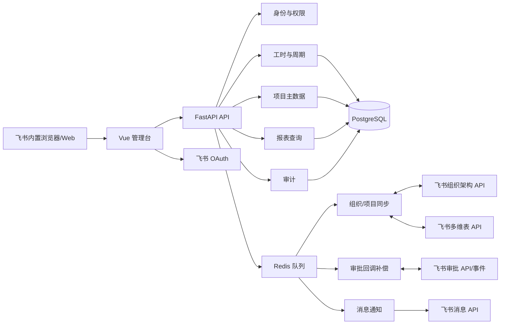
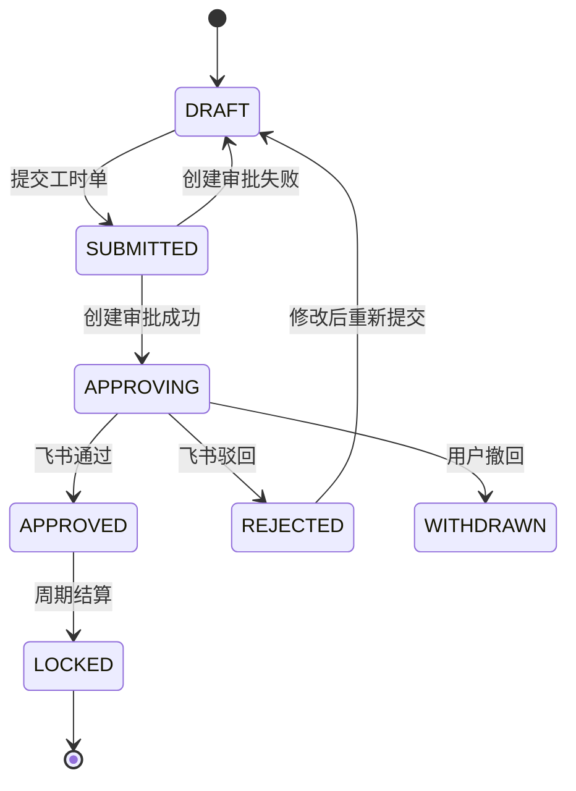

# 芯烨工时管理系统系统设计

> 版本：v1.0.1 ｜ 日期：2026-08-25 ｜ 状态：已修订

## 1. 技术选型

| 层面 | 选型 | 理由 |
|------|------|------|
| 前端 | Vue 3 + TypeScript + Vite | 适合表格、筛选和管理台交互，类型约束清晰 |
| 后端 | FastAPI + SQLAlchemy + Alembic | API 开发快，适合飞书集成、异步任务和 OpenAPI 契约 |
| 存储 | PostgreSQL | 关系、审批、审计和报表查询需要事务与索引 |
| 缓存/队列 | Redis + RQ 或 Celery | 处理回调重试、通知、组织同步和导出任务 |
| 部署 | Docker Compose 起步，HTTPS 反向代理 | 本地、测试、生产环境配置一致 |
| 第三方服务 | 飞书 OAuth、组织架构 API、审批 API、消息 API、多维表 API | 身份、组织、审批和历史兼容同步 |

多维表适配器使用飞书 Open API，不在业务代码中直接拼接页面操作。所有飞书凭证只从环境变量或密钥服务读取。

## 2. 架构总览



### 数据边界

- 飞书：用户、部门、审批流程和审批结果的外部权威来源。
- 本地数据库：工时、项目快照、审批关联、状态机、报表和审计的业务权威来源。
- 多维表：历史导入、过渡核对和可选回写目标，不直接参与主流程事务。

## 3. 模块划分

| 模块 | 职责 | 依赖 | 对应功能 |
|------|------|------|----------|
| auth | OAuth 登录、会话、权限 | 飞书 OAuth、users | F1 |
| directory | 用户/部门全量与增量同步 | 飞书组织 API、Redis | F2 |
| project | 项目同步、配置、可填报校验 | bitable、directory | F3 |
| worklog | 工时明细、校验、草稿 | project、directory | F4 |
| timesheet | 周期汇总、提交、锁账 | worklog、approval | F5、F7 |
| approval | 审批创建、回调、补偿、状态映射 | 飞书审批 API、Redis | F6 |
| report | 指标、下钻、导出 | PostgreSQL | F8 |
| bitable | 多维表读写、字段映射、迁移 | 飞书多维表 API | F9 |
| notification | 飞书消息、催办、重试 | 飞书消息 API、Redis | F10 |
| audit | 操作、状态和外部调用审计 | PostgreSQL | F1-F10 |

## 4. 数据模型

### 4.1 `users`

| 字段 | 类型 | 约束 | 说明 |
|------|------|------|------|
| id | uuid | PK | 本地用户 ID |
| feishu_user_id | varchar(64) | UNIQUE NOT NULL | 飞书 user_id |
| open_id | varchar(64) | UNIQUE | 当前应用 open_id |
| name | varchar(100) | NOT NULL | 用户名快照 |
| department_id | uuid | FK | 当前主部门 |
| manager_user_id | uuid | FK NULL | 直属上级 |
| employment_status | varchar(20) | NOT NULL | ACTIVE/INACTIVE |
| snapshot_at | timestamptz | NOT NULL | 快照时间 |

用户停用不删除；历史工时保留姓名和部门快照。

### 4.2 `departments`

| 字段 | 类型 | 约束 | 说明 |
|------|------|------|------|
| id | uuid | PK | 本地部门 ID |
| feishu_department_id | varchar(64) | UNIQUE NOT NULL | 飞书部门 ID |
| name | varchar(200) | NOT NULL | 部门名称 |
| parent_id | uuid | FK NULL | 父部门 |
| level | smallint | NOT NULL | 层级 |
| leader_user_id | uuid | FK NULL | 部门负责人 |
| is_active | boolean | NOT NULL | 是否有效 |
| snapshot_at | timestamptz | NOT NULL | 快照时间 |

### 4.3 `projects`

| 字段 | 类型 | 约束 | 说明 |
|------|------|--------|------|
| id | uuid | PK | 本地项目 ID |
| code | varchar(64) | UNIQUE | 项目编码，可兼容历史空值但新建必填 |
| name | varchar(300) | NOT NULL | 项目名称 |
| owner_user_id | uuid | FK NOT NULL | 项目负责人 |
| approver_user_id | uuid | FK NULL | 工时审批人 |
| leader_user_id | uuid | FK NULL | 主管领导 |
| department_id | uuid | FK NULL | 所属部门 |
| status | varchar(20) | NOT NULL | ACTIVE/PAUSED/CLOSED |
| allow_worklog | boolean | NOT NULL DEFAULT true | 是否可填报 |
| source_record_id | varchar(64) | UNIQUE | 多维表记录 ID |
| updated_at | timestamptz | NOT NULL | 更新时间 |

### 4.4 `worklogs`

| 字段 | 类型 | 约束 | 说明 |
|------|------|------|------|
| id | uuid | PK | 工时明细 ID |
| user_id | uuid | FK NOT NULL | 填报人 |
| user_name_snapshot | varchar(100) | NOT NULL | 填报时姓名 |
| department_path_snapshot | jsonb | NOT NULL | 填报时部门路径 |
| project_id | uuid | FK NOT NULL | 项目 |
| stage | varchar(20) | NOT NULL | 项目阶段 |
| work_type | varchar(20) | NOT NULL | PROJECT/MANAGEMENT/OTHER |
| work_status | varchar(20) | NOT NULL | LOCAL/BUSINESS_TRIP/LEAVE/REMOTE |
| start_date | date | NOT NULL | 开始日期 |
| end_date | date | NOT NULL | 结束日期 |
| quantity | numeric(10,2) | NOT NULL | 工时数量 |
| unit | varchar(10) | NOT NULL | DAY/HOUR |
| description | text | NOT NULL | 工作描述 |
| status | varchar(20) | NOT NULL | DRAFT/SUBMITTED/APPROVED/REJECTED/LOCKED |
| source_record_id | varchar(64) | UNIQUE | 多维表历史记录 ID |
| created_at | timestamptz | NOT NULL | 创建时间 |
| updated_at | timestamptz | NOT NULL | 更新时间 |

约束：`end_date >= start_date`；`quantity > 0`；项目必须 `allow_worklog=true`；已提交明细不能直接编辑。索引包括 `(user_id, start_date)`、`(project_id, start_date)`、`(status, updated_at)` 和 `(source_record_id)`。

### 4.5 `timesheets`

| 字段 | 类型 | 约束 | 说明 |
|------|------|------|------|
| id | uuid | PK | 工时单 ID |
| serial_no | varchar(32) | UNIQUE NOT NULL | 展示单号 |
| user_id | uuid | FK NOT NULL | 提交人 |
| period_start | date | NOT NULL | 周期开始 |
| period_end | date | NOT NULL | 周期结束 |
| total_quantity | numeric(12,2) | NOT NULL | 总数量 |
| unit | varchar(10) | NOT NULL | 主单位 |
| status | varchar(20) | NOT NULL | DRAFT/SUBMITTED/APPROVING/APPROVED/REJECTED/WITHDRAWN/LOCKED |
| version | integer | NOT NULL | 乐观锁版本 |
| submitted_at | timestamptz | NULL | 提交时间 |
| approved_at | timestamptz | NULL | 完成时间 |
| created_at | timestamptz | NOT NULL | 创建时间 |
| updated_at | timestamptz | NOT NULL | 更新时间 |

提交时将工时明细关联到工时单，并保存审批表单摘要；同一用户、周期和版本只能有一个有效提交单。

### 4.6 `approval_instances`

| 字段 | 类型 | 约束 | 说明 |
|------|------|------|------|
| id | uuid | PK | 本地审批关联 ID |
| timesheet_id | uuid | FK UNIQUE NOT NULL | 工时单 |
| definition_code | varchar(100) | NOT NULL | 审批定义编码 |
| instance_code | varchar(100) | UNIQUE NOT NULL | 飞书审批实例号 |
| status | varchar(20) | NOT NULL | PENDING/APPROVED/REJECTED/CANCELED |
| approver_snapshot | jsonb | NOT NULL | 创建时审批人快照 |
| raw_last_event | jsonb | NULL | 最近一次外部事件摘要 |
| last_synced_at | timestamptz | NULL | 最近同步时间 |

### 4.7 `approval_events`

| 字段 | 类型 | 约束 | 说明 |
|------|------|------|------|
| id | uuid | PK | 本地事件 ID |
| event_id | varchar(150) | UNIQUE NOT NULL | 飞书事件 ID |
| instance_code | varchar(100) | NOT NULL | 审批实例号 |
| event_type | varchar(80) | NOT NULL | 事件类型 |
| payload | jsonb | NOT NULL | 原始事件 |
| process_status | varchar(20) | NOT NULL | RECEIVED/PROCESSED/FAILED |
| retry_count | integer | NOT NULL DEFAULT 0 | 重试次数 |
| error_message | text | NULL | 错误信息 |
| received_at | timestamptz | NOT NULL | 接收时间 |

### 4.8 其他表

- `periods`：周期、截止时间、是否锁定、锁定人和锁定时间。
- `notifications`：通知类型、幂等键、接收人、发送状态、错误和重试次数。
- `sync_tasks`：组织/项目/多维表同步批次、游标、影响数和状态。
- `audit_logs`：操作者、对象、动作、旧值、新值、请求 ID和时间。

## 5. 状态机



状态转换只允许服务层执行；外部回调不能直接修改明细字段，只能通过审批实例映射工时单。

## 6. 接口定义

### 6.1 当前用户与组织

**GET `/api/v1/me`**

- 说明：返回当前登录用户、部门和权限。
- 成功响应：`{ "user": {...}, "roles": ["EMPLOYEE"], "permissions": [...] }`
- 错误：`AUTH_REQUIRED` 未登录；`USER_INACTIVE` 用户已停用。

**POST `/api/v1/admin/sync/directory`**

- 说明：创建组织架构同步任务。
- 请求：`{ "mode": "FULL|INCREMENTAL" }`
- 成功响应：`{ "task_id": "...", "status": "QUEUED" }`
- 错误：`FORBIDDEN` 无管理员权限；`FEISHU_RATE_LIMITED` 飞书限流。

### 6.2 项目

**GET `/api/v1/projects`**

- 参数：`keyword`、`status`、`allow_worklog`、`page`、`page_size`。
- 成功响应：`{ "items": [{"id":"...","code":"...","name":"...","approver":{}}], "page": {...} }`
- 错误：`INVALID_PARAMETER` 参数非法。

**POST `/api/v1/admin/projects/sync`**

- 说明：同步项目数据源并记录差异。
- 成功响应：`{ "task_id": "..." }`
- 错误：`SYNC_ALREADY_RUNNING` 已有任务；`BITABLE_ACCESS_DENIED` 无多维表权限。

### 6.3 工时

**GET `/api/v1/worklogs`**

- 参数：`period_start`、`period_end`、`user_id`、`project_id`、`status`、`page`、`page_size`。
- 成功响应：`{ "items": [{"id":"...","project":{},"quantity":1,"unit":"DAY","status":"DRAFT"}], "summary": {"quantity": 10} }`
- 错误：`INVALID_DATE_RANGE` 日期范围非法；`FORBIDDEN_SCOPE` 无权查看该用户数据。

**POST `/api/v1/worklogs`**

- 说明：创建工时草稿。
- 请求：

```json
{
  "project_id": "uuid",
  "stage": "DEVELOPMENT",
  "work_type": "PROJECT",
  "work_status": "LOCAL",
  "start_date": "2026-08-25",
  "end_date": "2026-08-25",
  "quantity": 1,
  "unit": "DAY",
  "description": "完成接口联调"
}
```

- 成功响应：`{ "id": "uuid", "status": "DRAFT", "validation": [] }`
- 错误：`PROJECT_NOT_FILLABLE` 项目不可填报；`DATE_RANGE_INVALID` 日期非法；`QUANTITY_EXCEEDED` 超过规则；`DUPLICATE_WORKLOG` 可能重复。

**PATCH `/api/v1/worklogs/{id}`**

- 说明：修改草稿或驳回工时。
- 请求：同创建接口的可修改字段 + `version`。
- 成功响应：更新后的工时明细。
- 错误：`WORKLOG_READ_ONLY` 工时已提交/通过/锁定；`VERSION_CONFLICT` 数据已被他人修改。

**DELETE `/api/v1/worklogs/{id}`**

- 说明：删除草稿；已进入审批的记录只能撤回或发起更正。
- 成功响应：`{ "deleted": true }`
- 错误：`WORKLOG_READ_ONLY`；`FORBIDDEN`。

### 6.4 工时单与审批

**POST `/api/v1/timesheets/preview`**

- 说明：校验周期内可提交明细并生成预览，不产生外部审批。
- 请求：`{ "period_start":"2026-08-01", "period_end":"2026-08-15", "worklog_ids":["uuid"] }`
- 成功响应：`{ "valid": true, "total_quantity": 10, "approver": {}, "issues": [] }`
- 错误：`NO_SUBMITTABLE_WORKLOG`；`APPROVER_MISSING`；`PERIOD_LOCKED`。

**POST `/api/v1/timesheets`**

- 说明：创建工时单并创建飞书审批实例；接口必须支持幂等键。
- 请求：`{ "period_start":"...", "period_end":"...", "worklog_ids":["..."], "idempotency_key":"..." }`
- 成功响应：`{ "timesheet_id":"...", "serial_no":"TS-20260825-0001", "status":"APPROVING", "approval_instance_code":"..." }`
- 错误：`IDEMPOTENCY_CONFLICT`；`APPROVAL_CREATE_FAILED`；`TIMESHEET_VALIDATION_FAILED`。

**POST `/api/v1/approvals/feishu/events`**

- 说明：接收飞书审批事件，验签后快速入队，业务处理异步完成。
- 请求：飞书事件 JSON。
- 成功响应：HTTP 200，`{ "received": true }`。
- 错误：`SIGNATURE_INVALID`；`EVENT_INVALID`。异常不应通过重复同步提交造成副作用。

**POST `/api/v1/timesheets/{id}/withdraw`**

- 说明：撤回仍处于审批中的工时单，并调用飞书撤回能力。
- 成功响应：`{ "status":"WITHDRAWN" }`
- 错误：`WITHDRAW_NOT_ALLOWED`；`FEISHU_OPERATION_FAILED`。

### 6.5 报表

**GET `/api/v1/reports/workload`**

- 参数：`period_start`、`period_end`、`department_id`、`project_id`、`user_id`、`status`、`unit`。
- 成功响应：

```json
{
  "scope": {"period_start":"2026-08-01","period_end":"2026-08-31","status":["APPROVED","LOCKED"]},
  "metrics": {"total_quantity": 166, "user_count": 5, "project_count": 18},
  "breakdowns": {"by_project": [], "by_user": [], "by_stage": []},
  "generated_at": "2026-08-25T10:00:00+08:00"
}
```

- 错误：`REPORT_SCOPE_TOO_LARGE`；`FORBIDDEN_SCOPE`；`EXPORT_NOT_READY`。

## 7. 关键流程实现

### 7.1 提交工时单与创建审批

1. 服务层开启数据库事务，锁定周期和草稿明细。
2. 校验项目可填报、单位一致、数量、审批人和版本号。
3. 创建 `timesheets`、明细关联和 `approval_instances` 的预备记录。
4. 事务提交后调用飞书审批创建接口；使用 `timesheet_id` 作为外部幂等键的一部分。
5. 成功则写入实例号并更新 `APPROVING`；失败则记录错误并回到 `SUBMITTED`，由队列重试。
6. 客户端只根据本地状态展示结果，不重复直接调用飞书。

### 7.2 审批回调

1. 验证飞书签名和事件格式。
2. 以 `event_id` 插入 `approval_events`，重复事件直接返回成功。
3. 投递异步任务，按实例号查询本地审批关联。
4. 使用数据库行锁检查状态是否允许转换。
5. 写入审批原始摘要、状态、意见和完成时间，更新工时单及明细。
6. 生成通知任务和审计记录；失败进入指数退避队列。

### 7.3 多维表历史导入

1. 读取字段配置和分页记录，保留原表/记录/字段 ID。
2. 先导入组织和项目，再导入工时明细。
3. `工时核算` 导入为 `DAY` 数量，不根据日期重新计算覆盖原值。
4. `审批状态` 映射为本地状态，无法识别的值进入异常队列。
5. 导入完成生成总数、成功数、失败数和差异报告。
6. 过渡期回写只更新白名单字段，禁止覆盖本地审批实例和审计字段。

## 8. 非功能设计

### 性能

- 列表接口 P95 小于 500ms，报表查询 P95 小于 2s，导出异步执行。
- 列表强制分页，默认 20、最大 100；报表按日/项目建立汇总索引或物化汇总表。
- 飞书调用统一限流、超时 10-30 秒、指数退避，不能阻塞用户请求超过 3 秒。

### 安全

- OAuth 会话使用短期 access token 和服务端安全 cookie；禁止前端保存租户密钥。
- 后端按用户、部门、项目角色校验数据范围，不能只依赖前端隐藏按钮。
- 回调接口验签、请求体大小限制、防重放；外部原始 payload 脱敏后保存。
- 审计日志不可由普通用户删除；导出记录操作者、筛选范围和时间。

### 异常处理

- 统一响应格式：`{ "code": "...", "message": "...", "request_id": "...", "details": {} }`。
- 外部调用失败进入可重试任务；超过最大次数进入死信状态并通知管理员。
- 审批回调乱序时以飞书查询到的最终状态为准，保留所有事件。
- 多维表同步失败不回滚本地工时，只标记同步状态并支持补偿。

### 可观测性

- 每次请求、飞书调用、队列任务和审批事件带 `request_id`/`trace_id`。
- 监控登录失败率、组织同步失败、审批创建失败、回调延迟、通知失败、死信数量和报表耗时。
- 管理台提供集成健康页，展示最近成功时间、失败任务和重试入口。

## 9. 接口/Service 文档与注释规范

- Python 接口和 Service 公共方法使用 docstring，说明职责、参数、返回值、错误码和副作用。
- 任何创建审批、发送通知、写回多维表的方法必须说明幂等键和失败补偿策略。
- 复杂状态转换注释写业务原因，不重复描述代码语句。
- 接口、注释、前端类型和本文档第 6 节必须在同一变更中同步。

## 10. 目录结构约定

```text
work-hours/
├─ backend/
│  ├─ app/
│  │  ├─ api/                 # HTTP 路由和请求模型
│  │  ├─ auth/                # OAuth、会话、权限
│  │  ├─ directory/           # 组织架构同步
│  │  ├─ project/             # 项目主数据
│  │  ├─ worklog/             # 工时明细和校验
│  │  ├─ timesheet/           # 周期工时单
│  │  ├─ approval/            # 飞书审批适配器和回调
│  │  ├─ bitable/             # 多维表适配器
│  │  ├─ report/              # 报表查询和导出
│  │  ├─ notification/        # 消息和催办
│  │  ├─ audit/               # 审计
│  │  └─ db/                  # 模型、迁移、事务
│  ├─ tests/
│  └─ alembic/
├─ frontend/
│  ├─ src/pages/
│  ├─ src/components/
│  ├─ src/services/
│  ├─ src/types/
│  └─ src/styles/tokens.css
├─ deploy/
├─ docs/
└─ README.md
```

## 变更记录

| 日期 | 原因 | 改动点 | 影响范围 |
|------|------|--------|----------|
| 2026-08-25 | 根据 PRD 和现有表结构设计 | 定义架构、模型、接口、状态机和异常策略 | 全部 P0/P1 |

---

**门禁**：本文档需用户确认技术方案后才能进入编码阶段。
