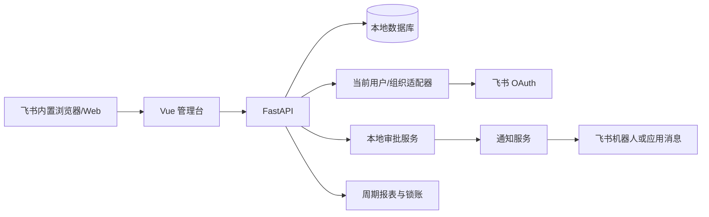
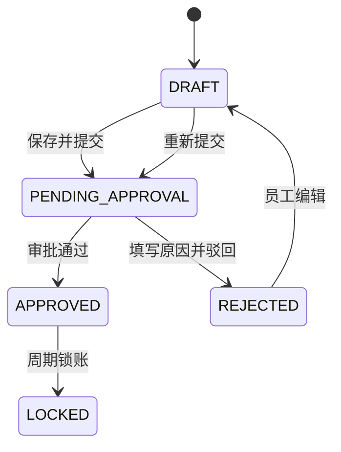

# 芯烨工时管理系统系统设计

> 版本：v2.0.30 ｜ 日期：2026-08-27 ｜ 状态：开发验证完成，待业务 UAT

## 1. 技术边界

继续使用当前 Vue 3 + TypeScript、FastAPI + SQLAlchemy、SQLite/Docker Compose 部署方式。SQLite 适合现阶段单实例 NAS MVP；数据量和并发增长后再迁移 PostgreSQL，不在本次审批改造中引入新基础设施。

飞书接入三类能力：OAuth 用户身份、组织架构同步和消息通知。审批不调用飞书审批 API；身份登录由飞书内置 H5 SDK 提供授权码，本系统后端直接换取用户身份，不需要 OAuth 回调地址。

## 2. 架构与数据流



数据权威边界：本地数据库权威维护工时、审批、通知、审计和报表；飞书组织架构权威维护用户身份；飞书消息只表示“提醒已发送/失败”，不表示审批结果。

### 2.1 OAuth 认证数据流

```text
飞书内页面 → H5 SDK requestAccess(scopeList: [], appID)；旧版客户端回退 requestAuthCode(appId)
浏览器 → POST /api/v1/auth/feishu/exchange {code}
系统 → app_access_token → code 换 user_access_token → user_info
       → open_id/user_id 匹配本地 ACTIVE 用户 → 签名 Session Cookie → 前端首页
```

Session 使用 Starlette `SessionMiddleware` 签名 Cookie，不保存飞书访问令牌；会话密钥和 Cookie Secure 开关只从环境变量读取。`FEISHU_MODE=app` 时业务接口只信任 Session，`mock` 时保留本地演示身份切换。

## 3. 数据模型调整

### 3.1 `users` 增加飞书身份

在现有 `User` 增加：

- `open_id`：当前飞书应用下的用户标识，可为空，唯一时生效。
- `email`：可选，用于人工绑定和排查。
- `snapshot_at`：最近组织快照时间。

### 3.2 `projects` 调整审批人

新增：

- `department_id`：外键，指向组织架构同步的 `departments.id`。

保留 `owner_name` 作为历史展示字段，新增：

- `owner_user_id`：外键，指向飞书组织同步的 `users.id`。
- `owner_open_id`：项目负责人身份快照，可为空。

保留 `approver_name` 作为历史展示字段，新增：

- `approver_user_id`：外键，指向 `users.id`。
- `approver_open_id`：提交时的身份快照，可为空。
- `leader_user_id`：外键，指向项目配置的上级领导用户，可为空。
- `leader_name`：上级领导当前姓名快照，可为空。
- `leader_open_id`：上级领导身份快照，可为空。

新提交先读取 `approver_user_id`；若审批人等于提交人，则读取 `leader_user_id` 作为实际审批人。姓名变化不影响已提交任务。新项目人员配置只能引用 `employment_status=ACTIVE` 的组织同步用户。

### 3.3 `worklogs` 作为审批单主体

保留现有周期字段兼容旧数据，新增：

| 字段 | 说明 |
|---|---|
| `approval_status` | DRAFT/PENDING_APPROVAL/APPROVED/REJECTED/LOCKED；逐步替代含义不清的 `status` |
| `approver_user_id` | 提交时锁定的审批人 |
| `approver_name_snapshot` | 提交时审批人姓名 |
| `submitted_at` | 最近一次提交时间 |
| `approved_at` | 最近一次通过时间 |
| `rejection_reason` | 当前驳回原因 |
| `approval_comment` | 通过意见，可选 |
| `approval_version` | 每次重新提交递增 |
| `last_notified_at` | 最近一次通知时间 |

为兼容当前前端和历史数据，第一版实现可以继续读写 `status`，同时保证取值统一为 `DRAFT`、`PENDING_APPROVAL`、`APPROVED`、`REJECTED`、`LOCKED`；后续再移除重复字段。

### 3.4 新增 `approval_tasks`

一条有效审批版本一条记录，核心字段：

| 字段 | 说明 |
|---|---|
| `id` | 本地审批任务 ID |
| `worklog_id` | 工时明细 ID，外键 |
| `version` | 审批版本，和工时重提次数对应 |
| `serial_no` | 展示单号，如 `WL-20260825-0001` |
| `submitter_user_id` | 提交人 |
| `approver_user_id` | 审批人 |
| `status` | PENDING/APPROVED/REJECTED |
| `comment` | 审批意见 |
| `submitted_at` / `processed_at` | 提交和处理时间 |
| `processed_by` | 实际处理人 |

约束：`(worklog_id, version)` 唯一；只有 `PENDING` 任务能处理；处理人必须等于 `approver_user_id`。

### 3.5 新增 `notifications` 和 `audit_logs`

`notifications` 保存 `approval_task_id`、接收人、渠道、幂等键、发送状态、重试次数、错误信息和发送时间。幂等键为 `approval_task_id + channel + version`。

`audit_logs` 保存对象类型/ID、动作、操作者、旧状态、新状态、意见、请求 ID和时间，审批状态变更不可物理删除。

### 3.6 `timesheets` 的新定位

不删除旧表，保留用于历史查询和未来周期锁账。新建工时不再写入 `timesheet_id`，周期只通过日期筛选。升级脚本将旧周期单中的每条工时拆成独立 `approval_tasks`，原 `timesheet` 标记为 legacy，保留旧单号和外部实例号供追溯。

## 4. 状态机



状态转换只由服务层执行，接口不得通过传入字符串直接改状态。提交、处理和重提使用事务，并以审批任务版本防止重复点击。

## 5. 接口契约

### 认证

**GET `/api/v1/auth/config`**

- 返回 `mode`、`feishu_login_enabled` 和 `auth_required`，不返回应用密钥。

**POST `/api/v1/auth/feishu/exchange`**

- 接收飞书 H5 SDK 返回的授权码，读取飞书用户信息，匹配本地启用用户并建立 Session；失败不建立会话。

**POST `/api/v1/auth/logout`**

- 清除当前 Session。

业务接口在 `FEISHU_MODE=app` 且无有效 Session 时统一返回 `401 AUTH_REQUIRED`。

### 工时

**POST `/api/v1/worklogs`**

- 职责：创建工时；`submit` 默认为 `true`，支持显式草稿。
- 输入：现有工时字段 + `submit: bool = true`。
- 输出：工时详情；提交时可通过 `GET /api/v1/worklogs/{id}/approval` 读取对应审批任务和通知状态。
- 错误：`PROJECT_NOT_FILLABLE`、`APPROVER_MISSING`、`APPROVER_SELF_NO_LEADER`、`DATE_RANGE_INVALID`、`QUANTITY_INVALID`。

**PATCH `/api/v1/worklogs/{id}`**

- 职责：仅修改 `DRAFT` 或 `REJECTED` 工时；不自动改变已提交任务。
- 错误：`WORKLOG_READ_ONLY`、`VERSION_CONFLICT`。

**POST `/api/v1/worklogs/{id}/submit`**

- 职责：提交一条草稿/驳回工时，创建新的审批版本和通知任务。
- 输出：`worklog`、`approval_task`、`notification`。
- 幂等：同一工时当前版本重复提交返回原任务。

**GET `/api/v1/worklogs/{id}/approval`**

- 职责：返回当前员工自己提交的最新审批版本，用于工时详情页。
- 输出：审批任务、工时快照和最近通知记录。
- 错误：`WORKLOG_NOT_FOUND`、`APPROVAL_NOT_FOUND`。

### 审批

**GET `/api/v1/approvals/pending`**

- 职责：返回当前登录审批人的待处理任务。
- 参数：`project_id`、`submitter_id`、`period_start`、`period_end`、`page`、`page_size`。
- 错误：`FORBIDDEN_SCOPE`、`INVALID_DATE_RANGE`。

**GET `/api/v1/approvals/{task_id}`**

- 职责：读取审批快照、工时详情、通知记录和审计时间线。
- 错误：`APPROVAL_NOT_FOUND`、`FORBIDDEN_SCOPE`。

**POST `/api/v1/approvals/{task_id}/approve`**

- 职责：当前审批人通过任务，可选填写意见。
- 输入：`comment` 可选、`version` 必填。
- 错误：`NOT_APPROVER`、`APPROVAL_ALREADY_PROCESSED`、`VERSION_CONFLICT`。

**POST `/api/v1/approvals/{task_id}/reject`**

- 职责：当前审批人驳回任务。
- 输入：`reason` 必填至少 2 个字、`version` 必填。
- 错误：`REJECTION_REASON_REQUIRED`、`NOT_APPROVER`、`APPROVAL_ALREADY_PROCESSED`。

**POST `/api/v1/approvals/{task_id}/remind`**

- 职责：按幂等策略重新发送当前待审任务通知。
- 错误：`APPROVAL_ALREADY_PROCESSED`、`NOT_APPROVER`、`NOTIFICATION_DISABLED`。

### 飞书应用消息通道

当 `FEISHU_NOTIFICATION_MODE=app` 时，通知适配器调用飞书
`POST /open-apis/im/v1/messages?receive_id_type=open_id`，使用租户访问令牌，
以 `msg_type=interactive` 将待审批摘要和“打开工时系统”按钮发送到任务审批人的飞书私聊。按钮不直接指向系统地址，而是指向飞书 AppLink WebView 协议，点击后由飞书客户端内置浏览器打开系统地址；不再把裸 URL 放在纯文本消息中。接收人的 `open_id`
必须来自组织架构同步快照，不能由前端传入或通过姓名猜测。

- 输入：审批任务单号、审批人 `open_id`、提交人、项目、日期、工时、工作描述和系统地址。
- 卡片行为：消息正文展示审批摘要；按钮 `打开工时系统` 的 `default_url` 使用 `https://applink.feishu.cn/client/web_url/open`，通过 `url` 参数编码系统地址，并设置 `mode=window`，由飞书客户端在内置 WebView 中打开目标页面。
- 输出：飞书返回的 `data.message_id` 写入 `notifications.message_id`，成功状态为 `SENT`。
- 错误：`FEISHU_APP_MESSAGE_NOT_CONFIGURED`、`FEISHU_APP_RECIPIENT_OPEN_ID_MISSING`、
  `FEISHU_APP_MESSAGE_TOKEN_FAILED`、`FEISHU_APP_MESSAGE_SEND_FAILED`。
- 飞书返回 HTTP 4xx/5xx 时，保留响应中的飞书 `code` 和 `msg`，便于定位应用能力或权限配置问题。
- 失败策略：通知失败只更新通知记录为 `FAILED`，不回滚已创建的本地审批任务；审批人可从审批详情再次催办。
- 飞书消息接口返回 `230013` 时，错误记录保留原始码并映射为“应用未对该用户开放”，供前端提示管理员检查应用可用范围；该错误不改变本地审批任务状态。
- 应用权限：飞书应用至少需要发送机器人消息所需的 `im:message:send_as_bot` 权限，且应用版本已发布到目标租户。

### v2.0.14 修改说明

应用私聊原先使用纯文本并直接展示裸 URL，部分客户端会将链接交给系统默认浏览器。互动卡片的直接 URL 行为仍可能受客户端策略影响，因此改用飞书官方 AppLink WebView 协议包装目标地址，审批人从飞书会话点击按钮即可进入飞书内置浏览器；本地审批、通知记录、失败重试和群机器人文本消息保持不变。

### 项目与报表

**GET `/api/v1/org/users`**

- 职责：返回飞书组织架构同步到本地的启用用户，供项目负责人、审批人和上级领导选择。
- 参数：`keyword`、`active_only`。
- 错误：`DIRECTORY_NOT_READY`。

**GET `/api/v1/org/departments`**

- 职责：返回组织架构同步到本地的启用部门，供项目部门选择。
- 参数：`active_only`。
- 错误：`DIRECTORY_NOT_READY`。

**POST `/api/v1/org/sync`**

- 职责：从飞书组织架构同步用户、部门和启用状态；同步失败不删除现有本地快照。
- 输出：同步时间、用户数、部门数和同步状态。
- 错误：`FEISHU_DIRECTORY_NOT_CONFIGURED`、`FEISHU_DIRECTORY_SYNC_FAILED`。

**POST `/api/v1/projects`**

- 职责：新增项目并引用组织用户负责人、审批人和上级领导。
- 输入：`code`、`name`、`owner_user_id`、`department_id`、`approver_user_id`、`leader_user_id`、`status`、`allow_worklog`。
- 错误：`PROJECT_CODE_EXISTS`、`USER_NOT_ACTIVE`、`PROJECT_INVALID`。

**GET `/api/v1/projects/{project_id}`**

- 职责：读取项目详情和当前人员配置。
- 错误：`PROJECT_NOT_FOUND`。

**PATCH `/api/v1/projects/{project_id}`**

- 职责：编辑项目基础信息和人员配置；只影响后续新提交。
- 错误：`PROJECT_CODE_EXISTS`、`USER_NOT_ACTIVE`、`PROJECT_INVALID`。

**DELETE `/api/v1/projects/{project_id}`**

- 职责：软删除项目，关闭填报并保留历史引用。
- 错误：`PROJECT_NOT_FOUND`、`PROJECT_ALREADY_DELETED`。

**PATCH `/api/v1/projects/{project_id}/approver`**

- 职责：管理员同时配置项目审批人和上级领导，保存用户 ID、姓名及身份快照；只影响后续提交。
- 输入：`approver_user_id: int`、`leader_user_id: int`。
- 输出：更新后的项目配置，包含 `approver_*` 和 `leader_*` 字段。
- 错误：`USER_NOT_ACTIVE`、`FORBIDDEN`。

### 提交时审批人解析

`submit_item()` 在事务内执行以下规则：

1. 读取项目审批人：先按有效 `approver_user_id`，再按有效 `approver_open_id`，最后按唯一的启用用户姓名匹配；匹配成功时回写项目的本地用户 ID、open_id 和姓名。三种方式都无法唯一匹配时返回 `APPROVER_MISSING`，姓名匹配到多个启用用户时返回 `APPROVER_AMBIGUOUS`。
2. 若项目审批人 ID 不等于提交人 ID，实际审批人为项目审批人。
3. 若项目审批人 ID 等于提交人 ID，读取项目上级领导；上级领导缺少、停用或 ID 等于提交人时返回 `APPROVER_SELF_NO_LEADER`。
4. 将最终实际审批人的 ID、姓名和 `open_id` 写入工时、审批任务和通知接收人快照；项目配置后续变更不影响已提交任务。

**GET `/api/v1/reports/workload`**

- 职责：按日期周期、一级部门汇总本地已通过/已锁定工时，并单独返回待审积压，供工时看板使用。
- 入参：`period_start`、`period_end`、`department_name`（可选；为空表示全部一级部门）。
- 一级部门口径：从 `Project.department_id` 追溯 `Department.parent_feishu_department_id` 到根部门；缺少项目部门的历史工时归入“未分配部门”。
- 输出：`scope` 返回周期、部门和统计状态；`metrics` 返回 `total_quantity`、`user_count`、`project_count`、`execution_project_count`、`pending_count`、`approved_count`；`breakdowns` 返回 `by_project`、`by_user`、`by_stage`、`by_status`、`by_work_type`、`by_department`。
- 统计条件：已通过/已锁定工时用于总量和分布；待审批数量按相同日期、部门条件统计；输出数量保留 2 位小数并按数量降序。
- 错误：`FORBIDDEN_SCOPE`、`REPORT_SCOPE_TOO_LARGE`、`INVALID_DATE_RANGE`。

**GET `/api/v1/reports/workload/export`**

- 职责：按报表相同的日期和一级部门筛选条件导出工时明细 CSV。
- 入参：`period_start`、`period_end`、`department_name`（可选）。
- 输出：UTF-8 BOM CSV；包含提交人、所属一级部门、项目、阶段、工时类型、工作状态、日期范围、工时天数、审批人、审批状态、提交时间和处理时间。
- 规则：只导出 `unit=DAY` 的工时，状态不在导出接口中额外过滤，以便管理人员查看当前范围内的完整明细；部门和日期校验与看板接口一致。
- 错误：`INVALID_DATE_RANGE`、`INVALID_DEPARTMENT`。

## 6. 通知适配器

接口：`notify_approval_submitted(task, recipient)`、`notify_approval_processed(task, result)`、`remind_approval(task)`。

配置模式：

- `mock`：开发和测试，不发外部消息。
- `webhook`：飞书群机器人 Webhook，消息包含单号、提交人、项目、工作描述、日期、工时和系统链接。
- `app`：飞书自建应用读取组织通讯录，并可按审批人 `open_id` 精确发送应用消息，适合正式使用。

Webhook、App ID、App Secret、加密密钥等只从 NAS 环境变量读取，不写进代码、压缩包或日志。组织同步失败保留上次本地快照；通知发送失败只更新 `notifications`，不回滚已提交审批任务。

## 6.1 工时单位与报表口径

- 新建和编辑接口的 `worklogs.unit` 固定为 `DAY`，前端不提供小时选择器，填报、审批和管理报表统一显示“天”。
- 历史 `HOUR` 记录保留在数据库中供追溯，但只读兼容，不参与新建、编辑和新的天数统计；系统不做未经确认的小时换算。
- 管理报表前端使用 ECharts，提供项目投入、人员分布、项目阶段、审批状态、项目阶段占比和工时类型六个图表；接口继续复用 `/api/v1/reports/workload`，并返回 `by_project_stage` 交叉明细。

## 6.2 工时审批 TAB

- `GET /api/v1/approvals/pending`：返回当前用户待处理的 `PENDING` 审批任务。
- `GET /api/v1/approvals/processed`：返回当前用户作为审批人处理过的 `APPROVED`、`REJECTED` 任务，按 `processed_at` 倒序；不返回其他审批人的历史记录。
- 两个列表复用 `ApprovalTaskView` 和审批详情页；待处理详情允许通过、驳回和重新发送通知，已处理详情只读。
- 前端主导航、工作台入口和移动端导航统一显示“工时审批”，页面内以“待我审批 / 已审批” TAB 区分工作状态。

## 6.2 集成与通知权限

- 环境变量 `SYSTEM_ADMIN_USER_IDS` 保存逗号分隔的本地用户 ID；未配置时开发环境默认用户 1 可作为管理员，生产环境必须显式配置。
- `GET /api/v1/me` 的 `roles` 按当前用户动态返回 `SYSTEM_ADMIN`。
- `POST /api/v1/org/sync` 在执行同步前校验当前用户为系统管理员；非管理员返回 HTTP 403、错误码 `ADMIN_REQUIRED`。
- 前端只对 `SYSTEM_ADMIN` 展示“集成与通知”导航和组织同步操作；项目选择页不再提供同步按钮。

## 7. 升级与回滚

1. 部署前停止写入并备份 `/app/data/workhours.db`。
2. 执行幂等 schema 升级：增加字段、创建审批任务/通知/审计表。
3. 迁移项目审批人姓名到用户关联；无法匹配的项目标记为“待配置审批人”。
4. 将旧 `APPROVING` 工时逐条生成本地 `PENDING` 任务；旧飞书实例号写入 legacy 备注，不自动覆盖本地结果。
5. 冒烟通过后恢复服务；失败时保留备份并恢复旧容器包。

## 8. 安全与非功能要求

- 所有审批接口后端校验用户身份和审批人 ID，不能只靠前端隐藏按钮。
- 通过/驳回使用数据库事务和版本号，重复请求最多产生一个状态变更。
- 通知链接要求登录；外部消息不携带密钥和过量敏感信息。
- 提交、处理、通知和项目审批人变更写审计；审计只追加不覆盖。
- 单实例 NAS 下接口目标 P95 < 500ms；通知调用设置超时和重试，不阻塞页面超过 3 秒。

## 9. 目录与实施边界

本次优先在现有单文件 FastAPI/Vue 结构上完成可部署 MVP，不提前拆成大型模块目录。实现稳定后再按 `approval`、`notification`、`audit` 拆分服务层。

## 变更记录

| 版本 | 日期 | 变更 |
|---|---|---|
| v2.0.17 | 2026-08-26 | 补充审批人失效绑定的回退解析、自动回写和重复姓名错误契约。 |

| 日期 | 原因 | 改动点 | 影响范围 |
|---|---|---|---|
| 2026-08-25 | 核心审批流程重构 | 工时单主体、审批任务、通知、接口、迁移和回滚设计 | 后端、前端、数据库、部署 |
| 2026-08-25 | 补充本人审批防呆 | 项目增加上级领导字段；提交时解析最终审批人并新增 `APPROVER_SELF_NO_LEADER` | 后端、前端、数据库、接口 |
| 2026-08-25 | 完善项目管理与人员来源 | 增加项目 CRUD、负责人用户字段、软删除、组织用户同步接口 | 后端、前端、数据库、接口 |
| 2026-08-25 | 收起新增表单并接入组织部门 | 增加项目部门外键、组织部门接口和按需展开表单 | 后端、前端、数据库、接口 |
| 2026-08-26 | 修复飞书内打开未认证 | 增加 H5 SDK 授权码换取、签名 Session、认证接口和前端登录态 | 后端、前端、部署、安全 |
| 2026-08-26 | 修复飞书登录按钮无响应 | 将 H5 SDK 固定为可访问的官方 CDN 版本；授权函数在 SDK 缺失或调用异常时返回可展示错误 | 前端认证、部署产物 |
| 2026-08-26 | 修复飞书授权失败信息丢失 | 保留 `requestAuthCode` 失败响应中的 `errMsg/code`，并为 `h5sdk.ready` 增加超时保护 | 前端认证、部署产物 |
| 2026-08-26 | 兼容新版飞书网页应用免登 | 按飞书官方文档优先调用 `requestAccess`，旧版客户端回退 `requestAuthCode` | 前端认证、部署产物 |
| 2026-08-26 | 兼容飞书授权服务异常 | `requestAccess` 返回 2700002 时重试 `requestAuthCode`，两条链路均失败时透传完整原因 | 前端认证、部署产物 |
| 2026-08-26 | 增加一级部门工时看板 | 报表接口增加部门筛选、一级部门追溯和项目/人员/阶段/状态/类型聚合 | 报表接口、前端看板 |
| 2026-08-26 | 接入飞书应用消息 | 应用消息使用审批人 `open_id` 私聊发送，保存飞书 `message_id`，补充配置和失败错误码 | 通知适配器、审批提交/催办、部署配置 |
| 2026-08-26 | 优化飞书消息打开方式 | 应用私聊由纯文本改为互动卡片，按钮通过 `open_url/default_url` 在飞书内置浏览器打开系统 | 通知适配器、消息验收 |
| 2026-08-26 | 修复卡片仍打开系统浏览器 | 应用卡片按钮改用飞书 AppLink WebView 协议包装系统地址，避免直接 URL 行为绕过飞书内置浏览器 | 通知适配器、消息验收 |
| 2026-08-26 | 优化填报、报表和集成管理 | 项目筛选增加名称/编码查询且不展示审批人；工时与报表统一按天统计并增加 ECharts 图表；组织同步迁移至管理员集成页并增加服务端权限校验 | 前端、报表接口、组织同步、部署配置 |
| 2026-08-26 | 对齐参考看板图表 | 报表接口增加项目×阶段交叉统计；前端按浅色风格渲染六类 ECharts | 报表接口、管理报表、移动端 |
| 2026-08-26 | 统一工时单位 | 新建/编辑固定 `DAY`，前端和报表移除小时口径；历史小时记录只读兼容 | 工时接口、前端、报表、数据兼容 |
| 2026-08-26 | 增加工时审批双 TAB | 新增已审批查询接口，审批导航改名为“工时审批”，已处理详情只读 | 审批 API、前端审批页、移动端 |
| 2026-08-26 | 完善工时详情和通知错误契约 | 提交后详情展示完整快照与审批时间；通知保留飞书业务错误码并提供可排查提示 | 工时接口、前端、通知适配器 |
| 2026-08-26 | 增加报表明细导出接口 | 新增按一级部门和日期范围导出天数明细的 CSV 接口，复用看板筛选口径 | 报表接口、前端、部署 |
| 2026-08-26 | 修复报表操作并优化布局 | 修正工时详情事件绑定；兼容内置浏览器的导出触发；调整报表页面信息层级与响应式样式 | 前端、报表、部署 |
| 2026-08-26 | 优化项目选择组件 | 工时填报使用可展开项目选择器，筛选输入跟随面板显示并在选择后关闭 | 前端、工时填报、移动端 |
| 2026-08-26 | 优化工时列表与提交结果页面 | 仅调整前端信息结构与响应式样式；不改变工时详情接口、审批状态机和通知契约 | 前端、移动端 |

**门禁**：系统设计确认后开始编码。
