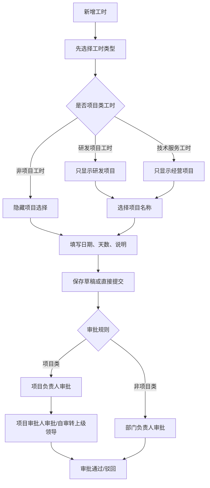
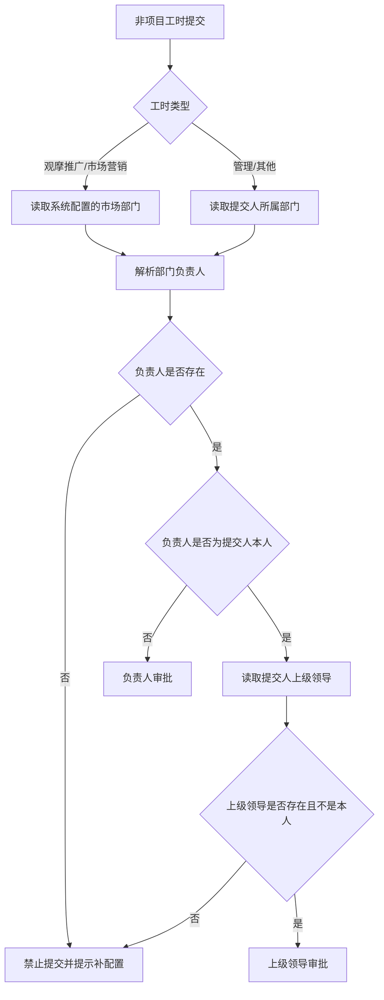
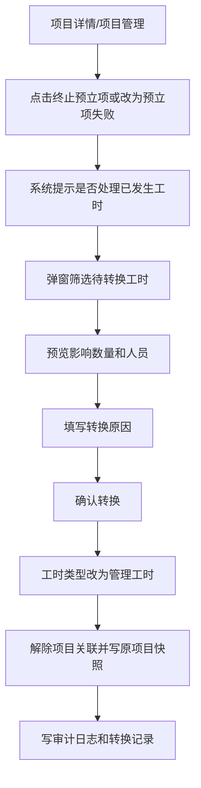

# v3.0.88 工时类型、二级审批与预立项工时处理设计

日期：2026-09-29  
状态：已确认并完成核心开发回归  
适用系统：综合项目管理系统 v3.0.88

## 实现记录

2026-09-29 已完成本设计的核心落地：

- 新增六类工时类型，保留 `PROJECT / MANAGEMENT / OTHER` 历史值兼容展示。
- 新增项目状态“预立项 / 预立项失败”，预立项项目允许填报工时。
- 工时填报改为先选工时类型：研发项目工时只选研发项目，技术服务工时只选经营项目；非项目工时不再关联项目。
- 项目类工时支持项目负责人 → 项目审批人的两级审批；审批人重复时自动合并，项目审批人为本人时转直属上级。
- 非项目工时支持部门负责人审批；负责人为本人时转直属上级。
- 飞书工时审批通知跟随当前审批节点发送，一级通过后自动派发二级待办。
- 后台“基础配置”新增组织审批配置，可维护部门负责人和人员直属上级。
- 飞书组织同步模型增加直属上级字段兼容，能返回时自动匹配本地人员。
- 预立项项目支持预览并批量转管理工时，转换后保留原项目、原因、操作人和时间留痕。
- 工时月度台账已落地，默认本月，支持项目汇总、明细下钻和导出。
- 后台工时台账、月度台账、明细下钻、导出、编辑、删除已统一接入 `worklogs` 数据范围控制。
- “转管理工时”必须同时具备项目编辑和工时编辑权限，避免只有项目维护权限的人批量改写工时分类。
- 工时类型/工作状态导出已改为读取基础配置中文标签，兼容 6 类新工时类型和历史旧值。
- 前端项目管理、工时台账、基础配置等危险操作按钮已按具体 RBAC 动作隐藏。
- 已通过后端 41 项回归测试、前端生产构建和后端编译检查。

## 0. 本轮已确认口径

本设计按以下用户确认口径落地，后续编码不得偏离：

1. 新增工时时先选择工时类型；项目类工时再选择项目名称，非项目工时不关联项目。
2. 研发项目工时、技术服务工时走二级审批：项目负责人审批 → 项目审批人审批；任一审批人等于提交人本人时，自动改由提交人的直属上级审批。
3. 观摩推广工时、市场营销工时不关联项目，由市场部门负责人审批；如果负责人本人提交，则转直属上级审批。
4. 管理工时、其他工时不关联项目，由提交人所属部门负责人审批；如果负责人本人提交，则转直属上级审批。
5. 部门负责人、市场部门、手工直属上级在系统后台维护；人员直属上级优先从飞书通讯录同步，系统手工配置可覆盖。
6. 项目状态新增“预立项”和“预立项失败”。预立项是否失败不由系统自动判断，必须由项目负责人或项目管理员在项目管理中手工确认。
7. 已审批通过的预立项项目工时转为管理工时后，保持已审批状态；审批中、已驳回、草稿按本文转换规则处理。
8. 本版本去掉“工时锁定”概念；预立项项目工时无论何时都允许转为管理工时，系统只负责留痕和重新归类。
9. 工时管理新增“工时月度台账”：默认本月，按项目汇总月工时，可导出，并可点击项目进入该项目该月工时明细。

## 1. 背景与目标

现有工时填报以“项目工时”为主，所有工时都必须选择项目，审批也只有一个最终审批人。新需求要求把工时先按业务类型分流：

- 项目类工时：研发项目工时、技术服务工时；
- 非项目类工时：观摩推广工时、市场营销工时、管理工时、其他工时；
- 项目类工时需要二级审批；
- 非项目类工时不关联项目，由部门负责人审批；
- 项目状态新增“预立项”和“预立项失败”，预立项失败时支持把相关项目工时批量转为管理工时，并保留完整留痕。

本设计目标是把工时入口从“先选项目”改为“先选工时类型”，让不同类型进入不同的项目范围和审批规则，同时保证历史工时、工时看板、工时台账和审批通知继续可追溯。

## 2. 术语与枚举

### 2.1 工时类型

新增一组明确的工时类型，建议后端枚举值如下：

| 中文名称 | 建议编码 | 是否关联项目 | 项目范围 | 审批方式 |
| --- | --- | --- | --- | --- |
| 研发项目工时 | `RND_PROJECT_WORK` | 是 | 项目大类 = 研发项目 | 二级审批 |
| 技术服务工时 | `TECH_SERVICE_WORK` | 是 | 项目大类 = 经营项目 | 二级审批 |
| 观摩推广工时 | `DEMO_PROMOTION_WORK` | 否 | 无 | 市场部门负责人审批 |
| 市场营销工时 | `MARKETING_WORK` | 否 | 无 | 市场部门负责人审批 |
| 管理工时 | `MANAGEMENT_WORK` | 否 | 无 | 所属部门负责人审批 |
| 其他工时 | `OTHER_WORK` | 否 | 无 | 所属部门负责人审批 |

说明：

- “研发项目工时”和“技术服务工时”仍然是项目工时，但用户不需要先选项目大类，系统根据工时类型自动过滤项目。
- “管理工时”包括会议、部门管理等。
- “其他工时”包括请假等暂未细分事项。
- 现有历史 `PROJECT / MANAGEMENT / OTHER` 工时保留，升级时只做兼容映射，不强制批量改历史记录。

### 2.2 项目状态

项目状态新增：

| 中文名称 | 建议编码 | 含义 | 是否允许填报工时 |
| --- | --- | --- | --- |
| 预立项 | `PRE_APPROVAL` | 项目尚未正式立项，但允许前期调研、方案、申报等工时归集 | 可配置，默认允许 |
| 预立项失败 | `PRE_APPROVAL_FAILED` | 预立项确认未成功，需要处理前期已发生工时 | 默认不允许继续填报 |

现有项目状态保留：

- 进行中 `ACTIVE`
- 验收中 `ACCEPTANCE`
- 已暂停 `PAUSED`
- 已完成 `COMPLETED`

项目管理页面新增“预立项”和“预立项失败”状态筛选和展示。

## 3. 业务流程设计

### 3.1 新增工时主流程



### 3.2 项目类工时二级审批规则

适用类型：

- 研发项目工时；
- 技术服务工时。

审批链：

1. 一级审批：项目负责人；
2. 二级审批：项目审批人；
3. 如果二级审批人就是提交人本人，则二级审批人自动改为提交人的上级领导。

特殊规则：

- 如果项目负责人就是提交人本人，一级审批是否跳过：建议不跳过，改为提交人的上级领导审批，避免自己审批自己的工时。若你希望一级允许项目负责人自审，需要再确认。
- 如果项目负责人和项目审批人是同一个人：建议系统只生成一个审批节点，避免同一个人重复点两次。
- 如果项目审批人替换为上级领导后，与一级审批人重复：同样去重，只保留一次。
- 如果找不到项目负责人、项目审批人或上级领导：提交时拦截并提示补配置。

推荐最终规则是“去自审、去重、缺人不提交”：

| 场景 | 处理 |
| --- | --- |
| 一级项目负责人 = 提交人 | 一级改为提交人上级领导 |
| 二级项目审批人 = 提交人 | 二级改为提交人上级领导 |
| 一级审批人与二级审批人相同 | 合并为一个节点 |
| 替换后的上级领导不存在 | 禁止提交，并提示维护上级领导 |
| 项目负责人/项目审批人未配置 | 禁止提交，并提示维护项目负责人/项目审批人 |

### 3.3 非项目工时审批规则

适用类型：

- 观摩推广工时；
- 市场营销工时；
- 管理工时；
- 其他工时。

审批链按工时类型分两类：

| 工时类型 | 审批人来源 | 自审处理 |
| --- | --- | --- |
| 观摩推广工时 | 市场部门负责人 | 如果提交人就是市场部门负责人，则转提交人的上级领导审批 |
| 市场营销工时 | 市场部门负责人 | 如果提交人就是市场部门负责人，则转提交人的上级领导审批 |
| 管理工时 | 提交人所属部门负责人 | 如果提交人就是所属部门负责人，则转提交人的上级领导审批 |
| 其他工时 | 提交人所属部门负责人 | 如果提交人就是所属部门负责人，则转提交人的上级领导审批 |

非项目工时整体流程：

1. 提交人提交；
2. 系统按工时类型解析审批部门；
3. 系统找到该审批部门负责人；
4. 如负责人就是提交人本人，则改为提交人的上级领导；
5. 审批人通过后工时完成；
6. 审批人驳回后工时回到已驳回，可修改后重新提交。

### 3.3.1 部门负责人和上级领导配置

当前系统现状：

- `departments` 表来自飞书组织架构，目前只保存部门名称、父部门和启停状态，没有负责人字段；
- `users` 表有 `manager_name` 字段，但当前飞书组织同步没有读取用户直属上级；
- 项目表里的“上级领导”只服务于项目审批链，不适合直接作为非项目工时的通用上级。

因此本版本需要新增一套“组织审批关系配置”，建议放在“系统管理 / 集成与通知”或“系统管理 / 基础配置”下新增入口：**组织审批配置**。

配置分为两层：

1. 部门负责人配置：
   - 每个部门可配置 1 名部门负责人；
   - 人员从飞书组织架构同步人员中选择；
   - 支持子部门继承上级部门负责人，但页面要明确显示“继承自哪个部门”；
   - 如果子部门有自己的负责人，以子部门配置优先。

2. 人员上级领导配置：
   - 飞书通讯录接口支持返回用户直属上级 ID（`leader_user_id`），但需要在飞书开放平台给应用开通“获取用户组织架构信息”等字段权限，并重新发布应用版本；
   - 系统同步组织架构时优先读取飞书返回的 `leader_user_id`，匹配到本地用户后保存为该人员的直属上级；
   - 每个人仍可在系统里手工配置 1 名上级领导，手工配置优先于飞书同步值，避免飞书数据缺失或公司临时授权关系变化时卡住审批；
   - 页面需要展示上级来源：飞书同步 / 手工配置；
   - 当审批负责人就是提交人本人时，系统使用该上级领导兜底。

市场部门负责人：

- 在“组织审批配置”里新增一个系统级字段：`市场部门`；
- 管理员选择一个部门作为市场部门，例如“市场营销部”；
- 观摩推广工时、市场营销工时统一取该部门的部门负责人作为审批人；
- 如果市场部门未配置，或市场部门负责人未配置，提交时拦截并提示“请先配置市场部门负责人”。

解析优先级：



飞书同步调整：

- 当前系统的 `DirectoryUser` 只同步了人员 ID、open_id、姓名、邮箱、部门和启停状态，没有解析直属上级；
- 需要把飞书用户列表返回里的 `leader_user_id` 加入同步模型；
- 同步用户时先保存 `leader_feishu_user_id`，待所有用户 upsert 完成后再二次匹配成本地 `supervisor_user_id`，避免上级用户还没入库时匹配失败；
- 如果飞书没有返回直属上级，则保留原有手工配置，不覆盖为空；
- 同步记录里增加“成功同步直属上级人数 / 未匹配直属上级人数”。

数据模型建议：

| 表 | 字段 | 说明 |
| --- | --- | --- |
| `department_approval_configs` | `department_id` | 部门 |
|  | `manager_user_id` | 部门负责人 |
|  | `inherit_parent` | 是否允许下级部门继承 |
|  | `updated_by / updated_at` | 维护留痕 |
| `user_supervisor_configs` | `user_id` | 人员 |
|  | `supervisor_user_id` | 上级领导 |
|  | `leader_feishu_user_id` | 飞书返回的直属上级 ID，便于重新匹配 |
|  | `source` | `MANUAL` / `FEISHU` |
|  | `updated_by / updated_at` | 维护留痕 |
| `system_settings` 或配置项 | `MARKET_DEPARTMENT_ID` | 市场部门 |

如果不想新增太多表，第一版也可以在 `departments` 增加 `manager_user_id`，在 `users` 增加 `supervisor_user_id`，但从后续可维护和留痕角度，独立配置表更稳。

### 3.4 预立项项目失败后的工时转管理工时

适用场景：

- 项目状态为“预立项”的项目；
- 后续确认未成功立项，需要把前期归集在该项目上的工时转为管理工时；
- 转换后工时不再计入该项目工时，但仍保留原项目来源留痕。

失败判定原则：

- 系统不自动判断预立项失败，因为是否立项成功属于业务决策，不能仅靠日期、工时数量或合同状态推断；
- 项目负责人或项目管理员在项目管理中点击“终止预立项”，或手工把项目状态改为“预立项失败”，才代表该项目预立项失败；
- 项目状态改为“预立项失败”时，系统弹出确认窗口，展示该项目下已有工时数量，并提示“是否立即转为管理工时”；
- 用户也可以先只改状态，之后再从项目列表、项目详情或后台工时台账进入“转管理工时”。

处理流程：



转换范围建议：

- 默认只转换该预立项项目下的工时；
- 支持按日期范围、人员、审批状态筛选；
- 默认包含草稿、审批中、已通过、已驳回；
- 不设置不可转换限制，后续无论是否月结、是否已审批，都允许通过该功能转换预立项项目工时。

转换后的状态建议：

| 原状态 | 转换后状态 | 原因 |
| --- | --- | --- |
| 草稿 | 草稿 | 未进入审批，不需要重审 |
| 已驳回 | 草稿 | 原审批已失效，重新按管理工时提交 |
| 审批中 | 草稿 | 关闭原审批任务，避免旧审批人继续处理 |
| 已通过 | 已通过 | 保留已审批事实，只改归类和项目归属，审计留痕 |

操作入口：

1. 项目管理列表：
   - 预立项项目显示“终止预立项”按钮；
   - 预立项失败项目显示“转管理工时”按钮；
   - 如果没有可转换工时，按钮置灰并提示“暂无可转换工时”。

2. 项目详情页：
   - 增加“预立项处理”卡片；
   - 展示预立项工时总数、已通过工时、审批中工时、已转出工时；
   - 提供“终止预立项并处理工时”“查看转换记录”两个入口。

3. 后台工时台账：
   - 筛选某个预立项失败项目后，可批量选择工时执行“转管理工时”；
   - 适合管理员处理历史遗留数据。

留痕要求：

- 每条被转换工时写入转换记录；
- 审计日志记录：操作人、操作时间、原项目、原工时类型、原审批状态、新工时类型、转换原因；
- 工时详情页展示“历史归属：原项目名称 / 原项目编号 / 转换人 / 转换时间 / 转换原因”；
- 后台工时台账支持查看转换标记。

## 4. 页面与交互设计

### 4.1 新增/编辑工时页面

调整前：项目类型 → 项目 → 工时内容。

调整后：

1. 第一项为“工时类型”，必须选择；
2. 选择“研发项目工时”：
   - 项目选择框显示；
   - 项目列表只显示项目大类为“研发项目”的项目；
   - 项目字段必填；
3. 选择“技术服务工时”：
   - 项目选择框显示；
   - 项目列表只显示项目大类为“经营项目”的项目；
   - 项目字段必填；
4. 选择非项目工时：
   - 项目选择框隐藏；
   - 项目阶段隐藏或置为“无”；
   - 工作说明提示调整为“请说明事项、参与内容或请假原因”；
5. 提交前展示审批预览：
   - 项目类：项目负责人 → 项目审批人/上级领导；
   - 非项目类：部门负责人；
   - 如果存在人员缺失，提交按钮禁用并给出维护提示。

### 4.2 我的工时

新增展示：

- 工时类型；
- 项目列对非项目工时显示“非项目工时”或“—”；
- 工时详情页展示审批链和当前审批节点；
- 如果工时由预立项项目转换而来，显示转换来源提示。

### 4.3 工时审批

列表新增/调整：

- 显示审批节点名称：项目负责人审批、项目审批人审批、部门负责人审批；
- 二级审批时，一级通过后任务自动进入二级审批人待办；
- 已审批 TAB 展示自己处理过的节点，不要求自己是最终审批人。

审批详情新增：

- 审批流轨迹；
- 一级/二级节点状态；
- 审批人替换说明，例如“项目审批人为提交人本人，已自动转上级领导审批”。

### 4.4 工时台账和工时看板

后台工时台账：

- 筛选项新增“工时类型”；
- 项目筛选对非项目工时不生效；
- 列表新增“是否项目工时 / 原项目来源 / 转换记录”。

工时月度台账：

- 菜单位置：工时管理 / 工时月度台账；
- 默认筛选：当前自然月，例如 2026-09；
- 筛选项：
  - 月份，默认本月；
  - 项目名称/项目编号；
  - 项目类型；
  - 项目状态；
  - 所属部门；
  - 项目负责人；
- 汇总口径：
  - 只按“项目”汇总项目类工时；
  - 非项目工时不进入项目月度汇总；
  - 汇总字段包括项目编号、项目名称、项目类型、项目状态、所属部门、项目负责人、本月填报人数、本月审批通过人天、本月审批中人天、本月驳回人天、本月合计填报人天；
  - “本月审批通过人天”用于项目正式统计，“本月合计填报人天”用于发现未完成审批的投入。
- 操作：
  - 点击项目名称或“查看明细”，进入该项目该月工时明细；
  - 明细页默认继承项目和月份筛选，列出人员、工时类型、填报日期、开始日期、结束日期、人天、审批状态、审批节点、工作内容；
  - 明细页支持返回月度台账；
  - 台账汇总和明细均支持导出。

工时看板：

- 按工时类型拆分统计；
- 项目维度统计只纳入研发项目工时和技术服务工时；
- 部门/人员维度统计包含全部工时；
- 非项目工时单独成组展示，避免混入项目排行。

导出：

- 导出明细增加工时类型、是否项目工时、原项目名称、转换原因。
- 工时月度台账导出增加两种模式：
  - 导出汇总：按项目一行；
  - 导出明细：按工时记录一行，可在明细页导出。

### 4.5 项目管理

新增/编辑项目：

- 项目状态下拉增加“预立项”和“预立项失败”；
- 预立项项目仍可配置项目负责人、项目审批人、上级领导、所属部门；
- 是否允许工时填报保持独立开关，预立项默认允许填报。

项目列表：

- 状态筛选增加“预立项”和“预立项失败”；
- 预立项、预立项失败项目使用独立标签颜色；
- 预立项项目操作栏显示“终止预立项”；
- 预立项失败项目操作栏显示“转管理工时”和“转换记录”；
- “终止预立项”执行后，状态变为“预立项失败”，并引导用户立即处理该项目已发生工时。

项目详情：

- 新增“预立项工时处理”区域：
  - 预立项累计工时；
  - 已通过工时；
  - 审批中工时；
  - 已转管理工时数量；
  - 待处理工时数量；
  - 最近转换记录；
  - 终止预立项入口；
  - 批量转管理工时入口。

## 5. 数据模型设计

### 5.1 Worklog 表建议新增/调整字段

现状：`worklogs.project_id` 必填。  
目标：支持非项目工时不关联项目。

建议调整：

| 字段 | 类型 | 说明 |
| --- | --- | --- |
| `work_type` | string | 改为新六类工时类型编码 |
| `project_id` | nullable int | 项目类必填，非项目类为空 |
| `project_name_snapshot` | nullable string | 项目类保存项目快照，非项目类为空或“非项目工时” |
| `approval_flow_type` | string | `PROJECT_TWO_LEVEL` / `DEPARTMENT_MANAGER` |
| `converted_from_project_id` | nullable int | 批量转管理工时时记录原项目 |
| `converted_from_project_name` | nullable string | 原项目名称快照 |
| `converted_at` | nullable datetime | 转换时间 |
| `converted_by` | nullable int | 转换操作人 |
| `conversion_reason` | text | 转换原因 |

兼容策略：

- 历史项目工时保留原 `project_id`；
- 历史 `PROJECT` 可显示为“项目工时（历史）”，或迁移为“研发项目工时/技术服务工时”需按项目大类判定；
- 历史 `MANAGEMENT` 迁移显示为“管理工时”；
- 历史 `OTHER` 迁移显示为“其他工时”。

### 5.2 ApprovalTask 设计

现状：一条工时每次提交只生成一个 `ApprovalTask`。

建议小改造而不是引入完整工作流引擎：

| 字段 | 类型 | 说明 |
| --- | --- | --- |
| `step_no` | int | 审批节点序号，1/2 |
| `step_name` | string | 项目负责人审批、项目审批人审批、部门负责人审批 |
| `flow_type` | string | 项目二级审批或部门负责人审批 |
| `status` | string | `PENDING/APPROVED/REJECTED/CLOSED/SKIPPED` |
| `resolved_reason` | text | 自审替换、去重、关闭等原因 |

处理方式：

- 提交时一次性生成审批链快照；
- 当前待办只有一个节点为 `PENDING`；
- 当前节点通过后：
  - 如果还有下一节点，下一节点变为 `PENDING` 并发送飞书通知；
  - 如果无下一节点，工时状态变为 `APPROVED`；
- 当前节点驳回后，整条工时变为 `REJECTED`，后续节点关闭。

### 5.3 新增转换记录表

建议新增 `worklog_conversion_logs`：

| 字段 | 说明 |
| --- | --- |
| `id` | 主键 |
| `batch_no` | 批次号 |
| `worklog_id` | 工时 ID |
| `from_project_id` | 原项目 |
| `from_project_name` | 原项目名称 |
| `from_work_type` | 原工时类型 |
| `to_work_type` | 新工时类型，固定管理工时 |
| `from_status` | 原审批状态 |
| `to_status` | 转换后状态 |
| `reason` | 转换原因 |
| `operator_id/operator_name` | 操作人 |
| `created_at` | 操作时间 |

### 5.4 工时月度台账数据口径

工时月度台账第一版不新增独立汇总表，直接基于 `worklogs`、`projects`、`users`、`departments` 实时聚合。

聚合维度：

- 月份：优先按工时填报日期或开始日期落月，具体以现有工时台账日期口径保持一致；
- 项目：只统计仍关联项目的项目类工时；
- 部门：取项目所属部门；
- 负责人：取项目负责人。

后续如果数据量变大，可再增加月度汇总缓存表，但第一版不提前复杂化。

## 6. 接口设计

### 6.1 工时类型选项

`GET /api/v1/worklogs/type-options`

返回：

```json
[
  { "value": "RND_PROJECT_WORK", "label": "研发项目工时", "requires_project": true, "project_type": "RND_PROJECT" },
  { "value": "TECH_SERVICE_WORK", "label": "技术服务工时", "requires_project": true, "project_type": "BUSINESS_PROJECT" },
  { "value": "DEMO_PROMOTION_WORK", "label": "观摩推广工时", "requires_project": false },
  { "value": "MARKETING_WORK", "label": "市场营销工时", "requires_project": false },
  { "value": "MANAGEMENT_WORK", "label": "管理工时", "requires_project": false },
  { "value": "OTHER_WORK", "label": "其他工时", "requires_project": false }
]
```

### 6.2 审批链预览

`POST /api/v1/worklogs/approval-preview`

用途：

- 前端选择工时类型、项目、日期后，预览将由谁审批；
- 提交前发现审批人缺失时提前提示。

入参：

```json
{
  "work_type": "RND_PROJECT_WORK",
  "project_id": 1
}
```

返回：

```json
{
  "flow_type": "PROJECT_TWO_LEVEL",
  "nodes": [
    { "step_no": 1, "step_name": "项目负责人审批", "approver_user_id": 3, "approver_name": "张三" },
    { "step_no": 2, "step_name": "项目审批人审批", "approver_user_id": 5, "approver_name": "李四" }
  ],
  "warnings": []
}
```

### 6.3 新增/修改工时

沿用现有：

- `POST /api/v1/worklogs`
- `PATCH /api/v1/worklogs/{id}`

调整：

- `project_id` 改为可空；
- 项目类工时必须传项目；
- 非项目类工时禁止传项目，或传了也忽略并提示；
- 提交时按新规则生成审批链。

### 6.4 批量转管理工时预览

`POST /api/v1/projects/{project_id}/worklogs/convert-to-management/preview`

入参：

```json
{
  "date_start": "2026-09-01",
  "date_end": "2026-09-30",
  "user_ids": [],
  "statuses": ["DRAFT", "PENDING_APPROVAL", "APPROVED", "REJECTED"]
}
```

返回：

```json
{
  "total": 12,
  "by_status": { "DRAFT": 2, "PENDING_APPROVAL": 3, "APPROVED": 7 },
  "by_user": [
    { "user_id": 1, "user_name": "杨阳", "quantity": 5 }
  ]
}
```

### 6.5 批量转管理工时执行

`POST /api/v1/projects/{project_id}/worklogs/convert-to-management`

要求：

- 必须填写转换原因；
- 必须具备项目管理或后台工时管理权限；
- 审批中工时需要关闭当前审批任务；
- 写审计日志和转换记录。

### 6.6 终止预立项

`POST /api/v1/projects/{project_id}/pre-approval/fail`

用途：

- 把项目从“预立项”改为“预立项失败”；
- 返回该项目下待处理工时概况，供前端提示是否立即转管理工时。

入参：

```json
{
  "reason": "客户暂缓立项，项目不再推进"
}
```

返回：

```json
{
  "project_id": 1,
  "status": "PRE_APPROVAL_FAILED",
  "worklog_summary": {
    "total": 8,
    "approved": 5,
    "pending": 2,
    "draft": 1,
    "convertible": 8
  }
}
```

### 6.7 工时月度台账汇总

`GET /api/v1/worklogs/monthly-ledger`

用途：

- 查询某个月每个项目的工时汇总；
- 默认月份为当前自然月；
- 作为“工时月度台账”主列表数据源。

入参：

```json
{
  "month": "2026-09",
  "project_keyword": "机器人",
  "project_type": "RND_PROJECT",
  "project_status": "PRE_APPROVAL",
  "department_id": 12,
  "owner_user_id": 3
}
```

返回：

```json
{
  "month": "2026-09",
  "total_projects": 12,
  "total_days": 248.0,
  "approved_days": 220.0,
  "pending_days": 18.0,
  "items": [
    {
      "project_id": 1,
      "project_code": "XM-2026-001",
      "project_name": "机器人集团智能调度系统",
      "project_type_name": "研发项目",
      "project_status_name": "预立项",
      "department_name": "产品研发部 / 信息化中心",
      "owner_name": "张三",
      "user_count": 6,
      "approved_days": 36.0,
      "pending_days": 2.0,
      "rejected_days": 0.0,
      "total_days": 39.0
    }
  ]
}
```

### 6.8 工时月度台账明细

`GET /api/v1/worklogs/monthly-ledger/{project_id}/details`

用途：

- 点击月度台账某个项目后，查看该项目该月所有工时明细；
- 默认继承主列表月份和项目。

查询参数：

```json
{
  "month": "2026-09",
  "status": "APPROVED",
  "user_id": 1
}
```

返回字段：

- 人员；
- 部门；
- 工时类型；
- 填报日期；
- 开始日期；
- 结束日期；
- 人天；
- 审批状态；
- 当前审批节点；
- 工作内容；
- 是否由预立项项目转出或转入。

### 6.9 工时月度台账导出

`GET /api/v1/worklogs/monthly-ledger/export`

导出模式：

- `mode=summary`：导出项目月度汇总；
- `mode=details`：导出某个项目某月工时明细；
- 不传月份时默认当前月。

## 7. 权限设计

新增或复用权限建议：

| 操作 | 权限 |
| --- | --- |
| 填报本人工时 | `worklogs:CREATE` |
| 审批工时 | `approvals:APPROVE` |
| 后台查看所有工时 | `worklogs:VIEW` |
| 后台修改工时 | `worklogs:EDIT` |
| 批量转管理工时 | 建议新增 `worklogs:CONVERT`，或第一版同时要求 `worklogs:EDIT` + `projects:EDIT` |
| 查看/导出工时月度台账 | `worklogs:VIEW` / `worklogs:EXPORT` |
| 维护部门负责人/上级领导 | 建议新增 `org_approval_config:CONFIGURE`，或归入 `configuration:CONFIGURE` |
| 项目状态变更 | `projects:EDIT` |

建议新增动作 `CONVERT`，原因是批量转换影响统计口径，比普通编辑风险更高。若不想扩权限体系，第一版可要求同时具备 `projects:EDIT` 和 `worklogs:EDIT`。

## 8. 飞书通知设计

项目类二级审批：

- 提交后给一级审批人发送“工时待审批”卡片；
- 一级通过后给二级审批人发送“工时待审批”卡片；
- 二级通过后给提交人发送“工时审批通过”通知；
- 任一级驳回后给提交人发送“工时审批驳回”通知。

非项目工时：

- 观摩推广、市场营销提交后给市场部门负责人发送待审批；
- 管理、其他提交后给提交人所属部门负责人发送待审批；
- 如果负责人为提交人本人，则给提交人的上级领导发送待审批；
- 审批通过/驳回后通知提交人。

卡片内容建议：

- 工时类型；
- 填报人；
- 日期范围和天数；
- 项目名称：项目类显示项目，非项目类显示“非项目工时”；
- 审批节点：项目负责人审批 / 项目审批人审批 / 部门负责人审批；
- 点击直达对应审批任务详情。

## 9. 统计口径设计

### 9.1 工时看板

项目投入：

- 只统计研发项目工时、技术服务工时；
- 预立项项目的工时在转换前计入项目，转换后不再计入该项目；
- 已转换工时可在“转换历史”或“管理工时”里追溯。

部门/人员投入：

- 统计所有工时类型；
- 支持按工时类型拆分。

### 9.2 项目详情

项目已发生人天：

- 只统计仍关联该项目的已通过项目类工时；
- 已转管理工时不计入该项目已发生人天；
- 预立项项目详情展示“已转出工时”。

### 9.3 导出

所有导出应增加：

- 工时类型；
- 是否项目工时；
- 当前项目；
- 原项目；
- 转换批次；
- 转换原因。

## 10. 数据迁移策略

1. 新增工时类型枚举配置；
2. 项目状态配置新增“预立项”；
3. `worklogs.project_id` 改为可空；
4. 新增组织审批配置：部门负责人、人员上级领导、市场部门；
5. 飞书组织同步扩展直属上级：申请权限后读取 `leader_user_id`，同步为人员上级领导默认值；
6. 历史工时兼容：
   - `PROJECT` 且项目大类为研发项目 → 可显示为“研发项目工时（历史）”；
   - `PROJECT` 且项目大类为经营项目 → 可显示为“技术服务工时（历史）”；
   - `MANAGEMENT` → 管理工时；
   - `OTHER` → 其他工时；
5. 历史审批任务仍按单节点展示，不强制迁移为二级审批。

## 11. 开发拆分计划

### 阶段一：基础配置和表结构

- 新增/迁移工时类型；
- 项目状态新增“预立项”；
- 新增组织审批配置：部门负责人、人员上级领导、市场部门；
- 飞书组织同步增加直属上级字段；
- 工时表支持非项目工时；
- 审批任务支持多节点链路。

### 阶段二：工时填报和审批

- 新增工时页面改为先选工时类型；
- 项目类工时按类型过滤项目；
- 非项目工时隐藏项目；
- 提交时生成审批链；
- 审批通过后自动流转下一节点；
- 飞书通知按节点发送。

### 阶段三：预立项转换

- 项目管理/项目详情增加批量转管理工时；
- 预览影响范围；
- 执行转换；
- 审计日志和转换记录；
- 工时详情展示原项目来源。

### 阶段四：看板、台账和导出

- 工时台账筛选和列展示；
- 工时月度台账汇总、明细下钻和导出；
- 工时看板类型拆分；
- 项目已发生人天口径调整；
- 导出字段补齐。

### 阶段五：回归与发布

重点回归：

- 原有项目工时新增、编辑、撤回；
- 同一天重复填报限制仍生效；
- 项目负责人/项目审批人自审替换；
- 非项目工时部门负责人审批；
- 飞书通知直达；
- 项目看板和项目详情工时统计；
- 后台台账导出。

## 12. 需要确认的设计点

以下是开发前已确认或本次补充明确的设计点：

1. 项目负责人是提交人本人时，一级审批自动转上级领导：已确认。
2. 项目负责人和项目审批人是同一人时，合并为一个审批节点：已确认。
3. 已通过工时批量转管理工时后，保持已通过状态，只改归类和项目归属，并完整留痕：已确认。
4. 预立项失败口径：不自动判断失败，由项目负责人或项目管理员点击“终止预立项”或改为“预立项失败”。
5. 非项目审批口径：观摩推广、市场营销由市场部门负责人审批；管理、其他由所属部门负责人审批；如果负责人本人提交，则转上级领导审批。
6. 转管理工时入口：项目管理列表、项目详情“预立项处理”、后台工时台账三个入口均可处理。
7. 工时锁定概念删除：预立项项目工时转换不再受锁定或月结限制，只要具备权限即可转换并留痕。
8. 工时月度台账：默认本月，按项目汇总月工时，可导出；点击项目进入该项目该月工时明细。

开发边界说明：

- “市场部门”不写死部门名称，由管理员在系统管理中选择飞书同步部门。
- 人员直属上级优先从飞书同步，本地手工配置可覆盖；部门负责人和市场部门负责人第一版在系统内维护，不强依赖飞书部门负责人字段。
- 如果飞书接口暂未返回直属上级，系统仍可通过手工直属上级配置完成审批兜底。
