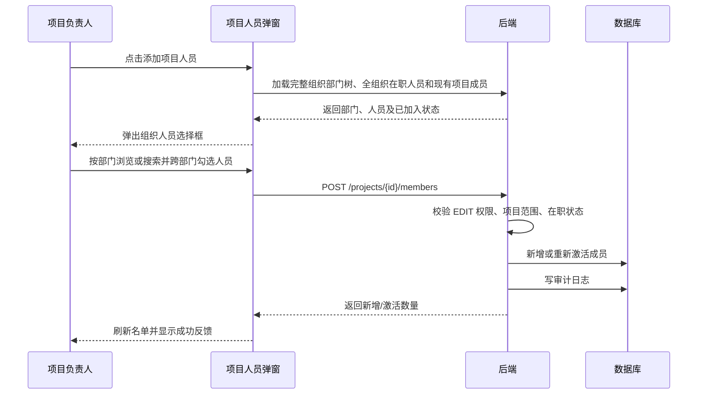
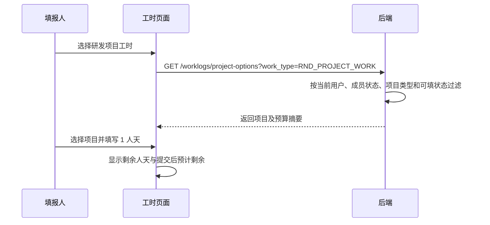

# v3.0.100 项目人员与人天预算控制设计

> 版本：v3.0.100 实施与发布说明
> 日期：2026-10-22
> 状态：已开发、测试并发布至 `116.169.217.29:8088`
> 设计范围：项目人员、项目人天预算、研发/技术服务工时项目选择与剩余人天提示
> 说明：本文同时作为需求设计、实现口径与发布验收记录。

## 1. 摘要

在项目管理中维护每个项目的有效人员名单。员工填报“研发项目工时”或“技术服务工时”时，只能选择自己当前参与且允许填报的项目；选择项目后立即看到预算人天、已占用人天、剩余人天和本次填报后的预计剩余。项目预算项页面恢复独立的“项目人天预算”，并在提交工时时由后端再次校验成员关系和剩余预算。

本期只约束项目类工时。观摩推广、市场营销、管理、其他等非项目工时不受项目人员名单限制。

## 2. 背景与目标（PRD）

### 2.1 当前问题

1. 当前工时项目选择器从所有可填报项目中过滤，员工可能误选自己未参与的项目。
2. 项目没有可维护的人员名单，项目负责人无法明确谁可以向项目填报工时。
3. 数据库仍保留 `projects.budget_days`，但 v3.0.60 起界面不再维护人天预算，项目负责人无法控制工时投入上限。
4. 填报人选择项目时看不到预算余额，容易在月底或事后才发现项目人天超支。
5. 前端筛选无法防止直接调用接口越权，成员资格与预算必须由后端作为最终判定。

### 2.2 目标

- 项目负责人可以在项目管理中维护项目人员。
- 普通员工填报项目类工时时，只看到自己所在的有效项目。
- 项目负责人可以设置项目总人天预算，并实时看到占用和剩余。
- 填报人选择项目后，无需离开页面即可判断还能填写多少工时。
- 后端在保存和提交时都校验成员资格；提交时原子校验预算，避免并发超额。
- 历史工时、历史审批和统计结果不因人员后续退出项目而丢失或失效。

### 2.3 成功指标

- 非项目成员通过页面或直接请求创建项目类工时的成功率为 0。
- 所有可填报项目均有负责人和至少 1 名有效项目人员。
- 选择项目后 1 次请求内返回人天预算与余额，正常情况下 500ms 内完成展示。
- 同一项目多人同时提交时，不出现“两个请求都校验通过后共同超预算”的情况。
- 上线后因“选错项目”产生的工时退回数量明显下降。

### 2.4 本期范围

| 编号 | 功能 | 优先级 | 说明 |
| --- | --- | --- | --- |
| F1 | 项目人员名单 | P0 | 项目管理增加人员入口，支持查看、批量添加、移除、检索 |
| F2 | 项目类工时按成员过滤 | P0 | 研发项目、技术服务工时只返回本人有效项目 |
| F3 | 项目人天预算 | P0 | 在项目预算项弹窗顶部独立维护总人天预算 |
| F4 | 剩余人天提示 | P0 | 选项目后展示预算、已占用、剩余、本次填报后预计剩余 |
| F5 | 超预算控制 | P0 | 未配置预算或本次填报后小于 0 时禁止提交 |
| F6 | 历史兼容与迁移 | P0 | 负责人及历史填报人初始化为项目人员，历史记录保持可查 |
| F7 | 人员与预算审计 | P1 | 添加、移除人员和修改人天预算写入现有审计日志 |

### 2.5 明确不做

- 不按人员拆分个人预算；预算只控制项目总人天。
- 不做成员在多个项目之间的自动排期、产能平衡或甘特图。
- 不把“项目人天预算”作为第 9 个金额预算项；人天和金额必须分区展示。
- 不改变现有项目类二级审批、非项目工时审批和工时快捷带入规则。
- 只有月度台账打印按 `1 人天 = 8 小时` 换算展示；项目管理、预算、填报、提示和接口均只使用“人天”。
- 不因人员退出项目删除或重算其历史工时。
- 不给系统管理员提供超预算强制提交入口；应先调整预算再提交。

## 3. 核心业务规则

### 3.1 项目人员

1. 每个项目必须有且只有 1 个“项目负责人”，负责人自动属于项目人员。
2. 项目负责人不能在项目人员弹窗中直接移除；需要先在项目基本信息中变更负责人。
3. 项目负责人变更后：新负责人自动成为有效负责人；原负责人降为普通成员，保留项目填报资格，项目管理者可随后手工移除。
4. 普通成员从飞书同步后的完整组织架构中选择，候选范围为全组织在职人员，不受项目所属部门或项目负责人部门限制；离职人员不可新增。
5. 移除采用软停用，保留加入、退出和操作审计。再次加入时激活原记录并更新加入时间。
6. 同一项目、同一用户只保留一条成员记录。
7. 项目成员资格只决定“能否新增、修改、重新提交项目类工时”，不决定能否查看历史本人记录。

### 3.2 项目可选范围

研发项目工时可选项目必须同时满足：

- 当前用户是有效项目成员；
- 项目大类为“研发项目”；
- 项目状态为“预立项”或“进行中”；
- 项目允许填报工时；
- 项目人员记录有效；
- 用户仍是在职状态。

技术服务工时使用相同规则，但项目大类必须为“经营项目”。

系统管理员填报自己的工时时也不突破成员限制。管理员可以先维护项目人员名单，但不能依靠管理员身份直接向任意项目填报。

### 3.3 人天预算与占用口径

项目人天预算继续复用现有 `projects.budget_days` 字段，单位为“人天”，支持 0.5 人天精度。

```text
已占用人天 = Σ 项目下状态为 PENDING_APPROVAL、APPROVED、LOCKED 的项目类工时 quantity
剩余人天 = 项目人天预算 - 已占用人天
本次填报后预计剩余 = 剩余人天 - 本次填报人天
```

口径说明：

- 草稿、驳回、已撤回、已删除记录不占用预算。
- 审批中已经占用预算，避免多人提交后在审批阶段超额。
- 已通过和已锁定继续占用预算。
- 预立项工时转为管理工时后不再关联项目，因此释放原项目占用。
- 编辑或重新提交同一条记录时，计算占用需排除当前记录 ID，再加上本次新数量，避免重复计算。
- 除月度台账打印外，页面与接口统一只使用“人天”，不提供小时换算字段或辅助文案。

### 3.4 预算状态与提交控制

| 条件 | 状态 | 页面表现 | 是否可提交 |
| --- | --- | --- | --- |
| `budget_days <= 0` | 未配置 | 红色文字 + “请联系项目负责人设置人天预算” | 否 |
| 使用率 `< 80%` | 正常 | 中性/绿色状态 | 是 |
| 使用率 `>= 80%` 且预计剩余 `>= 0` | 临近预算 | 黄色警告 + 剩余人天 | 是 |
| 本次填报后预计剩余 `< 0` | 超预算 | 红色错误 + 超出人天数 | 否 |
| 本次填报后预计剩余 `= 0` | 刚好用完 | 黄色提示“提交后预算将用完” | 是 |

保存草稿允许暂时超过预算，但页面必须显示警告；“保存并提交”和草稿后续“提交”必须阻止超额。成员资格无论保存草稿还是提交都必须校验，防止保存到不属于自己的项目。

## 4. 权限矩阵

复用现有 `projects` 的 `VIEW/EDIT` 和项目数据范围，不新增独立 RBAC 菜单。

| 操作 | 普通项目成员 | 项目负责人 | 有 `projects:EDIT` 的范围管理员 | 系统管理员 |
| --- | --- | --- | --- | --- |
| 在工时页看到本人参与项目 | 是 | 是 | 是，但仅本人参与项目 | 是，但仅本人参与项目 |
| 查看项目人员名单 | 仅有项目查看权限时可看 | 是 | 数据范围内可看 | 全部可看 |
| 添加/移除普通成员 | 否 | 负责项目可维护 | 数据范围内可维护 | 全部可维护 |
| 移除项目负责人 | 否 | 否 | 否，须先改负责人 | 否，须先改负责人 |
| 设置项目人天预算 | 否 | 负责项目可维护 | 数据范围内可维护 | 全部可维护 |
| 修改金额预算项 | 沿用现有权限 | 沿用现有权限 | 沿用现有权限 | 沿用现有权限 |
| 超预算强制提交 | 否 | 否 | 否 | 否 |

项目负责人当前通过内置 `project_owner` 角色具备负责项目的 `projects:EDIT`，因此可以自然落入上述规则；所有接口仍需后端校验项目数据范围。

## 5. 信息架构与页面设计

### 5.1 页面入口

```text
项目管理
├─ 项目行操作
│  ├─ 项目人员（新增）
│  └─ 预算项（增强：增加工时预算区）
└─ 项目详情
   └─ 人员与工时（显示人员名单摘要，维护仍复用项目人员弹窗）

我的工时
└─ 填报工时
   └─ 选择项目后显示预算余额条
```

项目列表操作顺序建议为：`详情 | 编辑 | 项目人员 | 预算项 | 更多`。移动端收进现有行操作菜单，避免按钮挤压。

### 5.2 项目人员弹窗

```text
┌──────────────────────────────────────────────────────────┐
│ 项目人员                                                  × │
│ 机器人调度系统 · RND-2026-015                              │
│ 负责人：张三                 有效人员 8 人                  │
├──────────────────────────────────────────────────────────┤
│ [搜索现有成员________________]          [＋ 添加项目人员]  │
├──────────────────────────────────────────────────────────┤
│ 人员        部门                 角色       加入时间    操作 │
│ 张三        产品研发部           负责人     2026-01-10  固定 │
│ 李四        技术研发中心         成员       2026-02-03  移除 │
│ 王五        应用创新中心         成员       2026-03-18  移除 │
└──────────────────────────────────────────────────────────┘
```

点击“添加项目人员”后打开独立的组织人员选择框：

```text
┌──────────────────────────────────────────────────────────┐
│ 添加项目人员                                              × │
│ 从组织架构中选择人员，可跨部门多选                           │
├────────────────┬─────────────────────────────────────────┤
│ 组织架构        │ [搜索姓名、邮箱或部门________________]    │
│ 全部人员 126    │ 全部在职人员 · 当前显示 6 人              │
│ ├ 产品研发部 42 │ □ 周晓敏   应用创新中心                    │
│ │ ├ 应用创新 18 │ □ 陈立峰   技术研发中心                    │
│ │ └ 技术研发 24 │ ☑ 李四     已加入本项目（不可重复选择）      │
│ ├ 质量管理部 16 │ □ 赵雪     质量管理部                      │
│ └ 市场营销部 21 │ □ 孙强     市场营销部                      │
├────────────────┴─────────────────────────────────────────┤
│ 已选择 2 人                         [取消] [添加所选人员]   │
└──────────────────────────────────────────────────────────┘
```

交互规则：

- “添加项目人员”打开独立的组织人员选择框，而不是在当前成员列表内展开候选项。
- 左侧展示完整组织部门树及人数，默认选中“全部人员”；选择父部门时包含其全部子部门人员。
- 右侧展示全组织在职人员，支持按姓名、邮箱或部门搜索、按部门筛选和跨部门一次勾选多人。
- 已在项目中的人员禁用并标注“已加入”；离职人员不出现在候选列表。
- 已选人数实时更新；未选择人员时“添加所选人员”按钮禁用。
- 确认添加后关闭人员选择框，返回项目人员名单并立即显示新增人员与成功反馈。
- 移除前二次确认：`移除后，该人员不能再向本项目新增或重新提交工时，历史记录不受影响。`
- 负责人行显示锁定图标与“项目负责人”标签，不提供移除按钮。
- 默认只显示有效成员；“查看已退出人员”作为次要筛选。
- 桌面端使用左侧组织树、右侧人员列表；移动端组织树变为顶部横向部门筛选，人员列表保持单列。

页面五态：

| 状态 | 表现 |
| --- | --- |
| 默认 | 人员表格、搜索、添加入口 |
| 加载 | 保留弹窗骨架，列表区显示 3 行骨架 |
| 空 | 理论上至少有负责人；迁移异常时提示“请先设置项目负责人” |
| 错误 | 列表区显示错误原因和“重新加载” |
| 成功 | 列表原位更新，顶部短暂显示“项目人员已更新” |

### 5.3 项目预算项弹窗

人天预算与金额预算使用不同单位，不能放进同一表格。弹窗顶部增加不嵌套卡片的“工时预算”横向区域，下面保留现有 8 项金额预算表。

```text
┌──────────────────────────────────────────────────────────┐
│ 项目预算项                                                × │
│ 机器人调度系统                                             │
├──────────────────────────────────────────────────────────┤
│ 工时预算                                                   │
│ 项目人天预算 [ 120.0 ] 人天   [保存工时预算]               │
│ 已占用 72 人天   已发生 68 人天   剩余 48 人天   60%       │
│ ████████████░░░░░░░░                                       │
├──────────────────────────────────────────────────────────┤
│ 金额预算：总预算 / 已发生 / 剩余 / 使用率                    │
│ [现有 8 项预算表保持不变]                                   │
└──────────────────────────────────────────────────────────┘
```

交互规则：

- 人天预算输入最小值 0、步长 0.5，最多 2 位小数。
- 新值小于当前已占用时不允许保存，提示至少应为当前已占用人天。
- 将预算设为 0 只允许在已占用为 0 时执行，并二次确认其会阻止项目类工时提交。
- 保存后只刷新工时预算区与项目汇总，不重载 8 项金额表。
- 金额预算说明改为“下方为金额预算项；工时预算单独按人天控制”。

### 5.4 工时填报页

选择项目后，在项目选择器下方展示紧凑状态带，不使用嵌套卡片。

```text
项目 *
[机器人调度系统                                      ▾]

剩余可填 48 人天
预算 120 人天  ·  已占用 72 人天  ·  使用率 60%
本次 1 人天，提交后预计剩余 47 人天
```

临近预算时：

```text
⚠ 剩余可填 2 人天，预算已使用 93%
本次 2 人天，提交后预算将用完
```

超预算时：

```text
! 本次填报将超出 0.5 人天
请减少填报天数，或联系项目负责人调整项目人天预算
```

交互规则：

- 切换工时类型时重新加载对应项目候选；研发与技术服务项目不混用。
- 切换项目或修改天数时即时重新计算“提交后预计剩余”，无需重复请求；提交时以服务端最新结果为准。
- “带入上次工时”只能带入当前仍有成员资格的项目。资格已失效时带入其他字段、清空项目，并提示重新选择。
- 无项目可选时显示：`你当前没有可填报的研发项目。请联系项目负责人将你加入项目人员。`
- 预算信息加载失败不允许提交项目类工时，提供“重新加载”。
- 保存草稿可继续；提交按钮在超预算或预算未配置时禁用，并同时显示文字原因。

### 5.5 设计 Token

沿用当前系统，不另起视觉体系：

| Token | 取值 |
| --- | --- |
| 主色 | `#0f766e` |
| 成功 | `#15803d` |
| 警告 | `#b45309` |
| 错误 | `#b91c1c` |
| 信息 | `#2563eb` |
| 页面/卡片背景 | `#f6f8fa` / `#ffffff` |
| 正文/次文字/边框 | `#344054` / `#667085` / `#d0d5dd` |
| 字号 | 12 / 14 / 16 / 20 / 24px |
| 间距 | 4 / 8 / 16 / 24 / 32px |
| 最小点击目标 | 44 × 44px |

预算状态不能只靠颜色表达，必须同时使用图标或明确文字。移动端弹窗改为底部面板，人员列表和预算表在面板内部滚动，页面本身不产生横向滚动。

## 6. 数据模型

### 6.1 新表 `project_members`

| 字段 | 类型 | 约束 | 说明 |
| --- | --- | --- | --- |
| `id` | integer | 主键 | 成员记录 ID |
| `project_id` | integer | 外键，非空 | 项目 ID |
| `user_id` | integer | 外键，非空 | 飞书同步本地用户 ID |
| `member_role` | varchar(20) | 非空 | `OWNER` / `MEMBER` |
| `status` | varchar(20) | 非空 | `ACTIVE` / `INACTIVE` |
| `joined_at` | datetime | 非空 | 最近一次加入时间 |
| `left_at` | datetime | 可空 | 最近一次退出时间 |
| `created_by` | integer | 外键，可空 | 首次添加人；迁移可为空 |
| `updated_by` | integer | 外键，可空 | 最近操作人 |
| `created_at` | datetime | 非空 | 创建时间 |
| `updated_at` | datetime | 非空 | 更新时间 |

约束与索引：

- 唯一约束：`(project_id, user_id)`。
- 查询索引：`(user_id, status, project_id)`，用于工时项目候选。
- 名单索引：`(project_id, status, member_role)`。
- 负责人同步约束由业务事务保证：项目 `owner_user_id` 必须存在对应 `OWNER + ACTIVE` 记录。

### 6.2 复用 `projects.budget_days`

不新增预算字段。现有 `projects.budget_days NUMERIC(12,2)` 重新定义为项目总人天预算，并在项目预算项弹窗中维护。

建议修复现有 `project_view()` 中 `remaining_days` 始终为 0 的问题：

```text
remaining_days = budget_days - occupied_days
```

同时区分：

- `actual_days`：只统计已通过/已锁定，用于已发生事实；
- `occupied_days`：审批中 + 已通过 + 已锁定，用于预算控制；
- `remaining_days`：预算 - 占用。

这样项目经营统计仍可使用已发生事实，工时提交控制使用占用口径，两者不混淆。

### 6.3 不修改 `worklogs`

工时继续保存 `project_id` 和 `project_name_snapshot`。不把成员记录 ID写入工时，避免成员退出或重新加入后破坏历史关联。提交时只验证“当前用户是否为当前项目有效成员”。

## 7. 接口契约

所有错误继续使用现有统一响应格式；下列仅列业务 `detail` 错误码。

### 7.1 读取项目人员

`GET /api/v1/projects/{project_id}/members?include_inactive=false`

权限：`projects:VIEW` + 项目数据范围。

响应示例：

```json
{
  "project_id": 15,
  "project_name": "机器人调度系统",
  "active_count": 8,
  "items": [
    {
      "id": 101,
      "user_id": 3,
      "user_name": "张三",
      "department_name": "产品研发部",
      "member_role": "OWNER",
      "status": "ACTIVE",
      "joined_at": "2026-01-10T09:00:00+08:00",
      "left_at": null,
      "can_remove": false
    }
  ]
}
```

### 7.2 批量添加项目人员

人员选择框复用现有组织架构接口：

- `GET /api/v1/org/departments?active_only=true`：加载完整有效部门树。
- `GET /api/v1/org/users?active_only=true&keyword=`：加载全组织在职人员；前端依据 `department_id` 和 `department_path` 完成部门树筛选。
- 打开选择框时同时读取现有项目成员，以禁用已加入人员；组织候选范围不应用项目数据权限过滤。

`POST /api/v1/projects/{project_id}/members`

权限：`projects:EDIT` + 项目数据范围。

请求：

```json
{ "user_ids": [5, 8, 13] }
```

规则：

- 只接受在职用户；重复添加幂等处理。
- 已退出成员重新激活；已有有效成员返回 `unchanged`。
- 单次最多 100 人，空数组返回校验错误。
- 同一事务写成员和审计日志。

响应：

```json
{ "added": 2, "reactivated": 1, "unchanged": 0 }
```

错误码：`PROJECT_NOT_FOUND`、`PROJECT_SCOPE_FORBIDDEN`、`USER_NOT_ACTIVE`、`PROJECT_MEMBER_BATCH_TOO_LARGE`。

### 7.3 移除项目人员

`DELETE /api/v1/projects/{project_id}/members/{user_id}`

权限：`projects:EDIT` + 项目数据范围。

规则：软停用；负责人禁止移除；重复移除幂等返回成功。

错误码：`PROJECT_OWNER_CANNOT_REMOVE`、`PROJECT_MEMBER_NOT_FOUND`。

### 7.4 读取和修改工时预算

`GET /api/v1/projects/{project_id}/workday-budget`

`PATCH /api/v1/projects/{project_id}/workday-budget`

读取权限：`projects:VIEW`；修改权限：`projects:EDIT`；均校验项目数据范围。

请求：

```json
{ "budget_days": 120.0 }
```

响应：

```json
{
  "project_id": 15,
  "budget_days": 120.0,
  "occupied_days": 72.0,
  "actual_days": 68.0,
  "remaining_days": 48.0,
  "usage_rate": 60.0,
  "status": "NORMAL"
}
```

修改规则：`budget_days >= occupied_days`；小于占用时返回 `WORKDAY_BUDGET_BELOW_OCCUPIED`。

### 7.5 工时项目候选

`GET /api/v1/worklogs/project-options?work_type=RND_PROJECT_WORK&keyword=`

权限：已登录用户。接口固定按当前用户成员关系过滤，不接受 `user_id` 参数。

响应：

```json
{
  "items": [
    {
      "project_id": 15,
      "project_code": "RND-2026-015",
      "project_name": "机器人调度系统",
      "project_type": "RND_PROJECT",
      "member_role": "MEMBER",
      "budget_days": 120.0,
      "occupied_days": 72.0,
      "remaining_days": 48.0,
      "usage_rate": 60.0,
      "budget_status": "NORMAL"
    }
  ]
}
```

该接口取代工时选择器对全量 `/api/v1/projects` 的前端过滤。关键词只筛选当前已授权集合，不能通过搜索探测其他项目。

### 7.6 现有工时接口校验增强

以下接口增加成员与预算校验：

- `POST /api/v1/worklogs`
- `PATCH /api/v1/worklogs/{id}`
- `POST /api/v1/worklogs/{id}/submit`
- 后台修改工时中涉及项目、类型或数量变更的接口

新增错误码：

| 错误码 | 含义 | 前端文案 |
| --- | --- | --- |
| `PROJECT_MEMBERSHIP_REQUIRED` | 当前用户不是项目有效成员 | 你不在该项目人员名单中，请联系项目负责人 |
| `PROJECT_MEMBER_INACTIVE` | 曾加入但已退出 | 你已退出该项目，不能继续填报 |
| `WORKDAY_BUDGET_NOT_CONFIGURED` | 人天预算为 0 | 项目尚未设置人天预算，请联系项目负责人 |
| `WORKDAY_BUDGET_EXCEEDED` | 提交后将超预算 | 项目剩余人天不足，请减少天数或调整预算 |
| `WORKDAY_BUDGET_CHANGED` | 页面展示后余额已变化 | 项目剩余人天已变化，请查看最新余额后重试 |

当返回预算错误时，响应附带最新预算摘要，前端可直接刷新提示：

```json
{
  "detail": "WORKDAY_BUDGET_EXCEEDED",
  "budget": {
    "remaining_days": 0.5,
    "requested_days": 1.0,
    "exceeded_days": 0.5
  }
}
```

## 8. 关键流程

### 8.1 新增项目人员



### 8.2 工时选择项目



### 8.3 提交时原子校验

1. 开启数据库写事务；SQLite 使用 `BEGIN IMMEDIATE` 或等效写锁策略，避免同一项目并发提交都读取旧余额。
2. 重新读取项目、当前用户成员记录和最新工时占用。
3. 排除当前编辑记录后，计算 `occupied + requested`。
4. 校验成员有效、项目可填、预算已配置、预计剩余不小于 0。
5. 校验通过后把工时状态改为审批中并创建审批任务；同一事务提交。
6. 校验失败则整体回滚，返回最新预算摘要。

通知仍在事务提交后发送，通知失败不回滚工时提交。

## 9. 历史数据迁移与上线策略

### 9.1 成员初始化

迁移脚本幂等执行：

1. 每个未删除项目的当前负责人写入 `OWNER + ACTIVE`。
2. 对历史项目类工时按 `project_id + user_id` 去重，补入成员记录。
3. 项目仍为预立项/进行中且人员仍在职时，历史填报人初始化为 `MEMBER + ACTIVE`，避免上线后突然无法填报。
4. 已离职人员或已结束项目的历史填报人初始化为 `MEMBER + INACTIVE`，只用于名单追溯。
5. 不修改任何历史工时、审批任务、项目名称快照和统计结果。

### 9.2 人天预算迁移

- 保留现有 `projects.budget_days` 原值，不清零、不覆盖。
- `budget_days > 0` 的项目上线后直接启用控制。
- `budget_days = 0` 视为“未配置”，不能提交新的项目类工时。
- 发布前必须生成“可填报但未配置人天预算的项目清单”，由项目负责人补齐。
- 上线门禁：所有 `allow_worklog = true` 且状态为预立项/进行中的项目，人天预算均已确认；否则暂不启用预算阻断。

### 9.3 灰度顺序

1. 部署表结构、迁移成员、上线维护界面和只读预算提示。
2. 项目负责人核对人员名单和未配置预算清单。
3. 数据核对完成后启用“成员限制 + 预算阻断”。
4. 启用后观察 1 个工作周的错误码数量和退回原因。

如果不做灰度开关，则发布前必须一次性完成第 2 步，避免大量正常填报被阻断。

## 10. 异常与边界

| 场景 | 处理 |
| --- | --- |
| 人员填好表单后被移出项目 | 提交时后端返回成员失效，保留表单内容并要求重选项目 |
| 项目预算在填报期间被他人调低 | 提交时以最新预算重算，返回最新余额 |
| 两人同时提交最后 1 人天 | 写事务串行校验，只允许先提交者成功 |
| 项目负责人变更 | 新负责人自动加入；旧负责人降为成员，不自动移除 |
| 项目暂停/完成 | 不出现在候选列表；已有草稿可查看但不能向该项目提交 |
| 人员离职 | 不再出现在候选项目；历史工时和名单历史保留 |
| 快捷带入上次项目但资格失效 | 带入其他字段，清空项目并提示 |
| 审批中工时被驳回 | 立即释放对应占用人天 |
| 审批中工时撤回 | 立即释放对应占用人天 |
| 预立项工时转管理工时 | 解除项目关联后释放项目占用 |
| 管理员后台改大工时数量 | 同样校验预算，不提供绕过入口 |
| 预算接口加载失败 | 不展示旧余额为最新值，项目类工时提交按钮禁用并允许重试 |

## 11. 验收标准

### 11.1 项目人员

1. 项目管理列表有“项目人员”入口。
2. 项目负责人自动在名单首行展示，不能直接移除。
3. 点击“添加项目人员”弹出独立人员选择框，左侧为完整组织树，右侧为全组织在职人员。
4. 可按部门浏览，按姓名、邮箱或部门搜索，并跨部门批量添加；已加入人员不可重复选择。
5. 移除普通成员后，该人员刷新工时页面即不再看到该项目。
6. 移除成员不影响其历史工时、审批记录和月度台账。
7. 无 `projects:EDIT` 或超出项目数据范围的用户不能修改名单，直接调用接口返回 403。

### 11.2 人天预算

1. 项目预算项弹窗顶部可设置项目人天预算，金额预算表保持原样。
2. 正确按人天显示预算、审批中占用、已发生、剩余和使用率，不显示小时换算。
3. 人天预算不能保存为小于当前已占用的值。
4. 修改人天预算写入审计日志，记录旧值、新值和操作人。

### 11.3 工时填报

1. 研发项目工时只显示本人参与的研发项目；技术服务只显示本人参与的经营项目。
2. 非项目工时不显示项目选择器，也不触发成员/预算校验。
3. 选择项目后按人天显示预算、已占用、剩余和本次提交后的预计剩余。
4. 使用率达到 80% 显示文字警告；不能只用颜色。
5. 未配置预算或超预算时可保存草稿，但不能提交。
6. 通过浏览器手工篡改 `project_id` 时，后端返回成员错误，不能写入越权项目。
7. “带入上次工时”不会保留当前已无资格的项目。

### 11.4 并发与回归

1. 两个请求竞争最后余额时最多一个成功，最终占用不超过预算。
2. 工时提交后的原有二级审批、飞书通知、批量审批正常。
3. 驳回、撤回、预立项转管理工时后预算占用正确释放。
4. 项目看板“已发生人天”仍只统计已通过/已锁定，不把审批中混入经营事实。
5. 只有月度台账打印继续按 `1 人天 = 8 小时` 换算；其他页面、提示及接口均只使用人天。
6. 桌面端 1440px 与移动端 390×844 无横向溢出、按钮热区不小于 44px。

## 12. 测试场景清单

| 类别 | 场景 |
| --- | --- |
| 成员正常路径 | 添加单人、批量添加、重复添加、退出后重新加入、移除普通成员 |
| 成员权限 | 普通成员越权、其他项目负责人越权、部门范围管理员、系统管理员 |
| 负责人 | 新建项目自动加入、负责人变更、尝试移除负责人 |
| 候选项目 | 研发/经营分类、暂停/完成项目、禁止填报项目、离职用户、关键字搜索 |
| 预算计算 | 0、0.5、80%、刚好用完、超 0.5、全链路人天口径 |
| 状态占用 | 草稿、审批中、通过、锁定、驳回、撤回、转管理工时 |
| 编辑重提 | 排除当前记录再计算、数量增大、数量减小、换项目 |
| 并发 | 2 人同时提交最后余额、预算修改与提交并发 |
| 快捷填报 | 上次项目仍有效、已退出、项目暂停、预算耗尽 |
| 历史迁移 | 负责人、历史填报人、离职人员、重复数据、脚本重复执行 |
| 关联回归 | 二级审批、通知、月度台账、打印、项目看板、预立项转换 |

## 13. 实施拆分建议

### 阶段一：数据与服务

- 新增 `project_members`、索引与幂等迁移。
- 抽取项目工时预算汇总服务，区分 `actual_days` 和 `occupied_days`。
- 增加成员、预算、工时候选接口。

### 阶段二：项目管理界面

- 项目行增加“项目人员”。
- 实现成员名单、批量添加、移除和五态。
- 项目预算项弹窗增加独立工时预算区。

### 阶段三：工时填报与强校验

- 项目选择器改用本人候选接口。
- 增加预算提示和预计剩余。
- 保存、提交、重新提交、后台修改统一执行成员与预算校验。

### 阶段四：迁移、测试与发布

- 生成成员初始化和未配置预算检查报告。
- 完成功能、权限、并发、UI 与关联回归。
- 项目负责人核对生产名单和预算后再启用强制限制。

## 14. 设计结论与待确认项

本设计默认采用以下推荐口径：

1. 项目负责人始终是项目人员；负责人变更后，原负责人保留为普通成员。
2. 审批中、已通过、已锁定均占用预算；草稿和驳回不占用。
3. 除月度台账打印外，预算、填报、提示和接口均只使用“人天”，不换算小时。
4. 人天预算未配置或超预算时允许保存草稿，但禁止提交。
5. 系统管理员填报个人工时时也必须在项目人员名单中，不设强制越权提交。
6. 复用 `projects.budget_days`，不新增第 9 个金额预算项。

项目人员、预算项和工时填报三处 HTML 交互原型位于 `docs/v3.0/prototype-v3.0.100/`；正式页面已按确认后的原型和业务规则完成开发。

## 15. 实施与验收结果

- 后端新增项目人员、项目人天预算、本人可选项目及提交预算校验接口，并完成负责人/历史填报人的幂等回填。
- 前端完成项目人员弹窗、组织架构人员选择器、人天预算区、本人项目筛选、剩余人天提示和超预算提交控制；保留“带入上次工时”。
- 除月度台账打印外，全部页面和接口继续使用人天；打印预览按 `1 人天 = 8 小时` 展示，并保留项目负责人、考勤员签字栏。
- 后端全量测试 `127 passed`；`compileall` 通过；前端 TypeScript 检查和生产构建通过。
- 桌面端与 `390×844` 移动端完成浏览器验收；浏览器控制台仅有非飞书客户端环境下预期的 H5 JS SDK bridge 提示。
- 2026-10-23 已发布至 `116.169.217.29:8088`，健康检查返回 `3.0.100`；部署文件备份为 `.backup-mcp-20261023-091257-v30100`，数据库发布前备份为 `workhours-pre-v30100-20261023-0917.db`。

## 变更记录

| 日期 | 原因 | 改动点 | 影响范围 |
| --- | --- | --- | --- |
| 2026-10-22 | 初始设计 | 新增项目人员、人天预算、成员项目过滤、剩余工时提示及超预算控制设计 | 项目管理、项目预算、工时填报、后端校验、数据迁移 |
| 2026-10-22 | 需求设计确认 | 生成项目人员、预算项、工时填报三页 HTML 交互原型，进入视觉确认门禁 | 原型与后续 UI 实现基准 |
| 2026-10-22 | 用户调整展示口径 | 除月度台账打印外统一只显示人天，不提供小时换算 | 设计稿、接口契约、三页原型 |
| 2026-10-22 | 用户调整人员添加交互 | 添加人员改为独立组织人员选择框，支持完整组织树、全员搜索和跨部门多选 | 项目人员交互、组织接口复用、验收标准、原型 |
| 2026-10-23 | 开发、测试与生产发布 | 完成项目人员、人天预算、成员项目过滤、剩余人天提示、超预算阻断及全量回归 | 后端、前端、数据库迁移、生产环境 |
